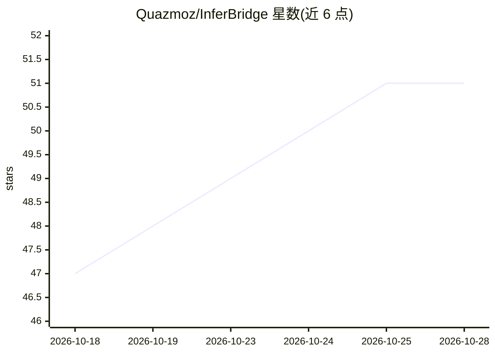

# Quazmoz/InferBridge

⭐ 51 · Python · MIT · 推送 2026-10-27 · [GitHub](https://github.com/Quazmoz/InferBridge) · 个人维护

**Windows 本地 LLM 服务器：OpenVINO GenAI 驱动 Intel CPU/GPU/NPU**

面向 Intel 硬件 Windows PC 的本地推理服务器：以 OpenVINO GenAI 为运行时，提供 OpenAI 兼容的 chat/completions、responses、embeddings 接口（含流式与视觉模型图像输入），支持 CPU/GPU/NPU/AUTO 及复合设备目标。附带模型下载转换加载的完整生命周期管理、恢复与回滚机制、System Doctor 硬件诊断、基准测试、浏览器聊天 UI，以及 Hugging Face 安全访问。提供 Windows 安装器、便携 ZIP 与源码运行三种方式；模型权重需另行下载。README 明确硬件证据仅来自一台 Core Ultra 9 185H 设备，安装包尚未 Authenticode 签名。

## 筛选速览

| 维度 | 判定 | 备注 |
|---|---|---|
| AI 角色 | `ai-ecosystem` | LLM/agent 周边工具 |
| 许可风险 | `permissive` | MIT |
| 部署形态 | `desktop` | 安装包/桌面程序 |
| 模型依赖 | — | README 未给出锁定关系 |
| 硬件要求 | — | 无带数字的原话,不猜 |
| 安装摩擦 | `low` | 无编译、无系统依赖或容器化 |
| 成熟度 | — | 结构信号不足 |

## 能力要点

- OpenAI 兼容 /v1/chat/completions、/v1/responses、/v1/embeddings 接口
- CPU/GPU/NPU/AUTO 及 MULTI/HETERO 复合设备目标
- 模型下载-转换-加载全生命周期管理，含恢复与回滚
- 内置浏览器聊天 UI、System Doctor 诊断与硬件基准测试

## 适用场景

- 在 Intel Windows PC 上本地运行 LLM 并以 OpenAI 兼容接口接入其他客户端
- 为 Open WebUI 或 n8n 提供本地推理后端
- 针对 Intel NPU/GPU 做设备定向推理与基准测试

## 场景标签

`推理引擎` · 领域:训练与推理

## 证据(README 行号)

> L3: **Local AI for Intel hardware. Powered by OpenVINO GenAI.**
> L5: InferBridge turns Intel Windows PCs into local AI workstations. It provides a Windows-first, OpenAI-compatible serve
> L183: - `POST /v1/chat/completions` with streaming and non-streaming responses

## 星数曲线

2026-10-18 47 → 2026-10-28 51（+4）

---
*卡片 v1 · prompt 1.4 · 生成 2026-10-24 · 置信度 mid · 依据 README sha `68f351aa560d` · [字段定义](../../DATASET.md)*
