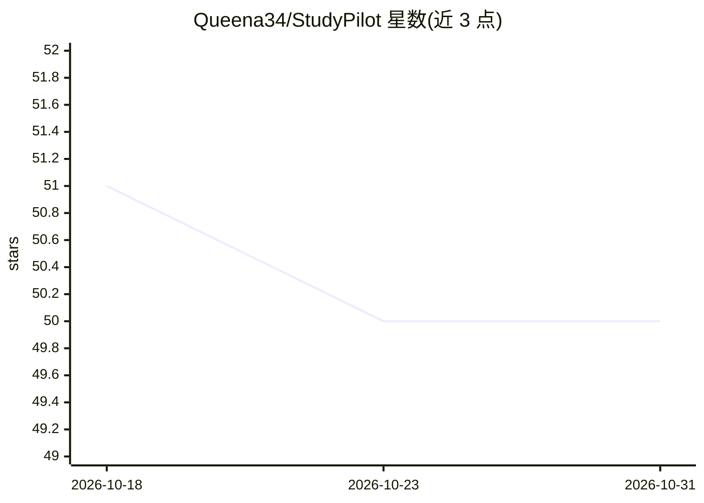

# Queena34/StudyPilot

⭐ 50 · Python · MIT · 推送 2026-09-04 · [GitHub](https://github.com/Queena34/StudyPilot) · 个人维护 · 中文 README

**面向国际研究生的双语 AI 学习教练，仅依据自有课程资料带引用讲解**

用户上传 PDF/Markdown/TXT 课程资料，系统异步解析、切分、嵌入并写入 ChromaDB 向量库；问答只从资料内检索作答，带文件名与页码引用，资料未覆盖则明示不答。中文提问英文资料时先翻译再检索。另提供练习生成与 rubric 批改、掌握度汇总与学习计划。运行栈为 FastAPI + PostgreSQL + ChromaDB + Docker，模型通过 Anthropic API 密钥接入；不配置密钥时可跑通检索链路但不生成回答。明确不做心理危机、医疗法律等专业场景。

## 筛选速览

| 维度 | 判定 | 备注 |
|---|---|---|
| AI 角色 | `ai-native` | 本体是模型或模型工具 |
| 许可风险 | `permissive` | MIT |
| 部署形态 | `self-host` | docker 或自建部署 |
| 模型依赖 | — | README 未给出锁定关系 |
| 硬件要求 | — | 无带数字的原话,不猜 |
| 安装摩擦 | `low` | 无编译、无系统依赖或容器化 |
| 成熟度 | — | 结构信号不足 |

## 能力要点

- 回答仅基于上传资料，带文件名页码引用，未覆盖内容明示不答
- bge-small-en-v1.5 嵌入（ONNX，随镜像分发），向量+词汇融合打分
- 规则优先的意图路由，LLM 仅在约 40% 路由用例被调用
- 十一套版本化评测集，其中三套无模型调用可入 CI

## 适用场景

- 上传课程资料，让 AI 只按资料内容带引用地讲解概念
- 生成并自动批改单选/多选/简答/概念解释题
- 根据作答记录的薄弱知识点安排每日复习计划

## 场景标签

`文档问答` · 领域:知识与检索

## 证据(README 行号)

> L3: 面向国际研究生的双语 AI 学习教练。上传课程资料，StudyPilot 只依据这些资料带引用地讲解概念、生成可批改的练习、按 rubric 逐条评分，并根据实际掌握度安排复习计划。
> L39: 不配置模型密钥也能跑通上传、解析、检索和引用链路 —— 此时返回可验证的检索结果而非生成式回答。配置后获得带 `[c1]` 引用的完整讲解：

## 星数曲线

2026-10-18 51 → 2026-10-31 50（-1）

---
*卡片 v1 · prompt 1.4 · 生成 2026-10-25 · 置信度 high · 依据 README sha `b6f341061d3f` · [字段定义](../../DATASET.md)*
