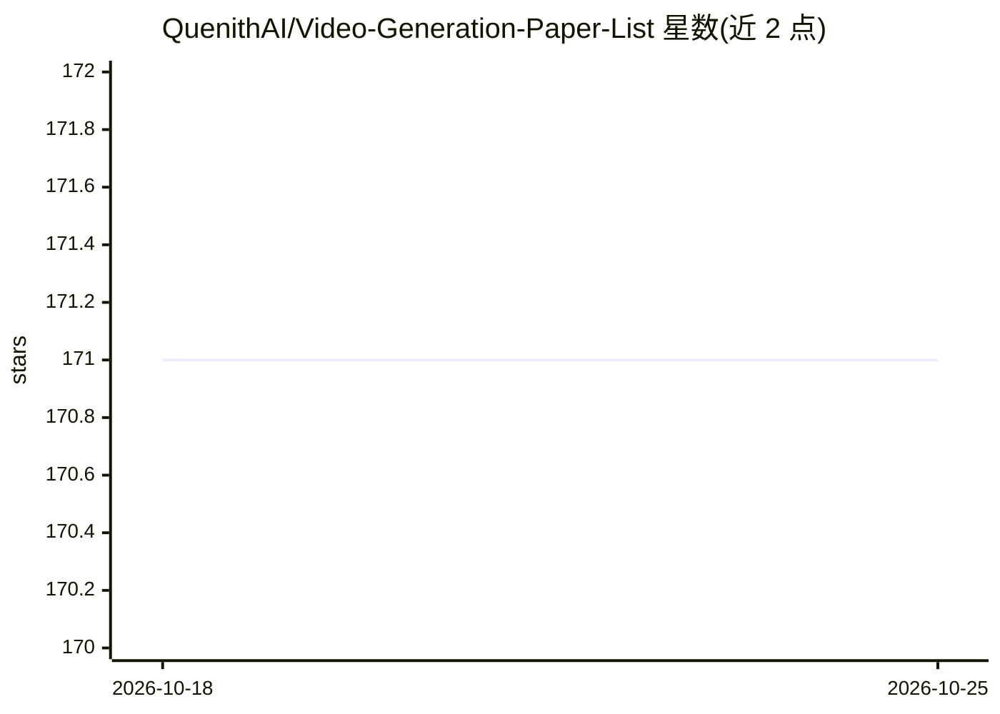

# QuenithAI/Video-Generation-Paper-List

⭐ 171 · 推送 2026-03-28 · [GitHub](https://github.com/QuenithAI/Video-Generation-Paper-List) · 组织维护 · 中文 README

**视频生成领域论文与模型策展清单（ Awesome List）**

由 QuenithAI（应达学术）科研导师团队维护的视频生成论文聚合仓库：按综述、Text-to-Video、音频驱动生成、强化学习方向等类别组织条目，每条列出会议出处（AAAI/CVPR/ICLR/ICCV/NeurIPS 等）、论文链接、项目页、GitHub 与 Hugging Face 链接；区分已发表论文与 Pre-Print，并按年份（2025/2026）划分。更新记录显示持续跟踪各顶会接收论文。README 同时以中文重复说明，并附科研辅导 1V1 联系入口。

## 筛选速览

| 维度 | 判定 | 备注 |
|---|---|---|
| AI 角色 | `ai-knowledge` | 知识聚合/清单类 |
| 许可风险 | `none` | — |
| 部署形态 | `None` |  |
| 模型依赖 | — | README 未给出锁定关系 |
| 硬件要求 | — | 无带数字的原话,不猜 |
| 安装摩擦 | `low` | 无编译、无系统依赖或容器化 |
| 成熟度 | — | 结构信号不足 |

## 能力要点

- 按会议与年份组织已发表/Pre-Print 论文条目
- 每条目链接 Paper/Project Page/GitHub/Hugging Face
- 覆盖综述、T2V、音频驱动、强化学习等方向

## 适用场景

- 查找视频生成方向某顶会的最新论文
- 按主题浏览综述与子方向文献
- 通过项目页与代码链接跟进论文实现

## 场景标签

`精选清单` `科研工具` · 领域:学习与行业

## 证据(README 行号)

> L6:  A curated collection of papers, models, and resources for the field of Video Generation.
> L15: > This repository is proudly maintained by the frontline research mentors at **QuenithAI (应达学术)**. It aims to provi

## 星数曲线

2026-10-18 171 → 2026-10-25 171（+0）

---
*卡片 v1 · prompt 1.4 · 生成 2026-10-22 · 置信度 high · 依据 README sha `29f97315614d` · [字段定义](../../DATASET.md)*
