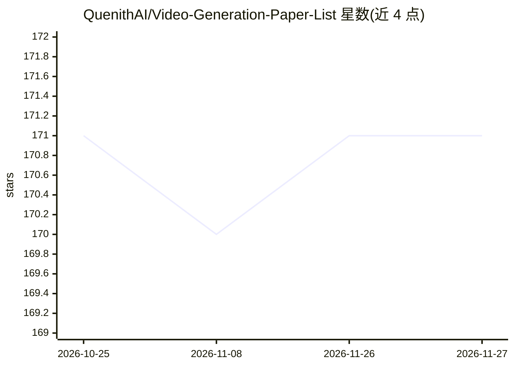

# QuenithAI/Video-Generation-Paper-List

⭐ 171 · 推送 2026-11-14 · [GitHub](https://github.com/QuenithAI/Video-Generation-Paper-List) · 组织维护 · 中文 README

**视频生成领域论文追踪清单，面向科研人员**

由 QuenithAI（应达学术）维护的视频生成领域论文与资源清单，按综述、文生视频等方向组织，按 CVPR、ECCV、ICLR、NeurIPS、AAAI、ACM MM、ICLR、ICML 等会议分类收录论文条目，条目附 Paper、Project Page、GitHub、Hugging Face 等链接。更新日志记录各会议录取论文的持续收录，欢迎通过 issue 与 PR 参与共建。README 同时提供科研论文投稿的 1V1 指导联系方式，为商业服务引流。

## 筛选速览

| 维度 | 判定 | 备注 |
|---|---|---|
| AI 角色 | `ai-knowledge` | 知识聚合/清单类 |
| 许可风险 | `none` | — |
| 部署形态 | `None` |  |
| 模型依赖 | — | README 未给出锁定关系 |
| 硬件要求 | — | 无带数字的原话,不猜 |
| 安装摩擦 | `low` | 无编译、无系统依赖或容器化 |
| 成熟度 | — | 结构信号不足 |

## 能力要点

- 按会议（CVPR/ECCV/ICLR/NeurIPS/AAAI 等）与研究方向组织论文条目
- 持续更新各会议录取论文（更新日志至 2026 年 11 月）
- 条目附 Paper/Project Page/GitHub/Hugging Face 链接
- 新增 Audio-Driven 与 Reinforcement Learning for Video Generation 方向

## 适用场景

- 查找视频生成方向的最新发表论文
- 跟踪各顶会视频生成录取论文动态
- 调研文生视频、世界模型等细分方向的研究脉络

## 场景标签

`精选清单` `科研工具` · 领域:学习与行业

## 证据(README 行号)

> L6:  A curated collection of papers, models, and resources for the field of Video Generation.
> L49: ### ✍️ Survey Papers

## 星数曲线

2026-10-25 171 → 2026-11-27 171（+0）

---
*卡片 v1 · prompt 1.4 · 生成 2026-11-26 · 置信度 high · 依据 README sha `42f888177af9` · [字段定义](../../DATASET.md)*
