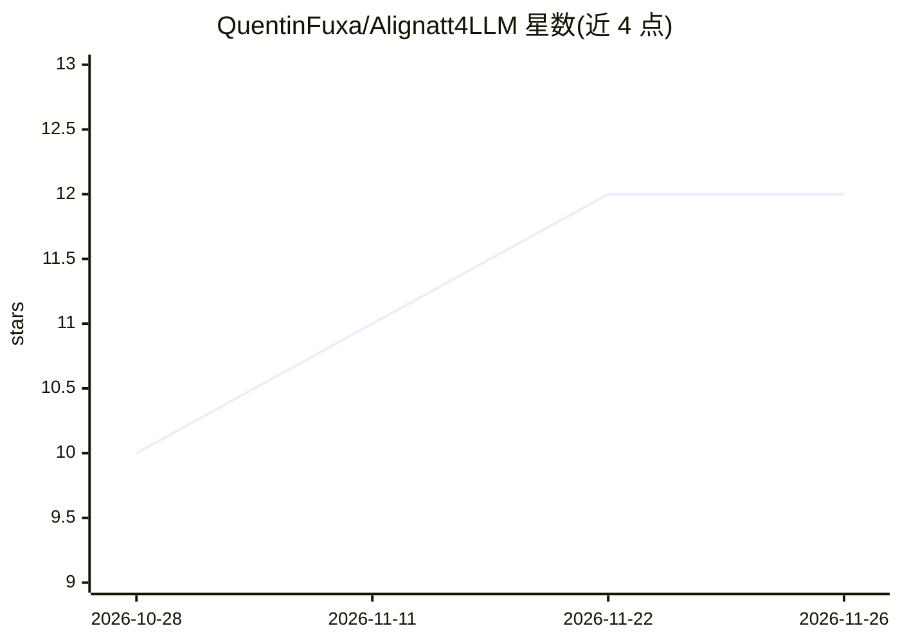

# QuentinFuxa/Alignatt4LLM

⭐ 12 · Python · MIT · 推送 2026-11-07 · [GitHub](https://github.com/QuentinFuxa/Alignatt4LLM) · [官网](https://arxiv.org/abs/2606.03967) · 个人维护

**面向研究者的同声传译语音翻译研究代码**

IWSLT 2026 同声传译任务的研究代码：将 AlignAtt 策略适配到 decoder-only LLM，通过校准少量对齐注意力头重建目标到源的注意力，在 vLLM 运行时捕获 Q/K 并用融合 kernel 重算注意力以降低解码延迟。提供 ASR+MT 端到端级联、多个 CLI 工具（批处理、A/B 对比、评测）以及作为 WebSocket MT 服务对接外部 ASR 前端的模式。模型需预先手动下载到本地 Hugging Face 缓存。

## 筛选速览

| 维度 | 判定 | 备注 |
|---|---|---|
| AI 角色 | `ai-native` | 本体是模型或模型工具 |
| 许可风险 | `permissive` | MIT |
| 部署形态 | `None` |  |
| 模型依赖 | local-ok | 支持本地模型 |
| 硬件要求 | — | 无带数字的原话,不猜 |
| 安装摩擦 | `medium` | 含编译或系统依赖之一 |
| 成熟度 | — | 结构信号不足 |

## 能力要点

- 基于校准注意力头的 where-to-cut 策略，对每个草稿 token 输出 accessible/inaccessible 注意力质量判定
- 在 vLLM 内运行时捕获 Q/K 并重算选定头的注意力，兼容 CUDA graphs
- 提供 alignatt-batch/compare/eval/preset 等 CLI 及 trace-attention 实时注意力追踪
- MT 侧支持按 VLLAttentionSpec 接入新的 decoder-only LLM，附 Qwen3 示例

## 适用场景

- 复现 IWSLT 同声传译任务的实验结果
- 研究 decoder-only LLM 中的翻译对齐注意力头
- 为外部 ASR 前端搭建 WebSocket 翻译后端并测延迟
- 按低/高延迟预设运行同传级联

## 场景标签

`模型评测` `语音识别` `科研工具` · 领域:评测与运维

## 证据(README 行号)

> L8: **AlignAtt4LLM** adapts AlignAtt to decoder-only LLMs for simultaneous speech translation. The MT model drafts a tra
> L46: The IWSLT implementation is end-to-end: it includes ASR, chunk-synchronous runtime code (synchronicity comes from t
> L135: - `alignatt-batch`: run the streaming cascade over one or more media files.

## 星数曲线

2026-10-28 10 → 2026-11-26 12（+2）

---
*卡片 v1 · prompt 1.4 · 生成 2026-11-18 · 置信度 high · 依据 README sha `fd88acaa4ae7` · [字段定义](../../DATASET.md)*
