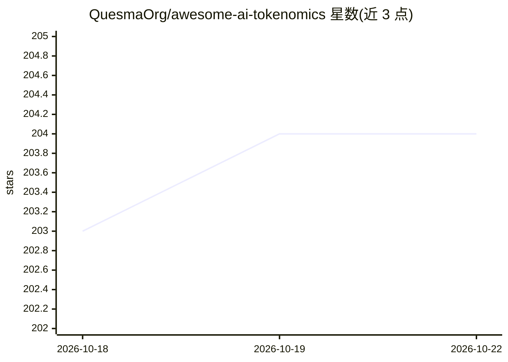

# QuesmaOrg/awesome-ai-tokenomics

⭐ 204 · Python · CC0-1.0 · 推送 2026-10-20 · [GitHub](https://github.com/QuesmaOrg/awesome-ai-tokenomics) · 组织维护

**AI token 经济学策展清单：token 成本、测量、优化与治理工具集**

由 QuesmaOrg 维护的 awesome 清单，聚焦 LLM 与编程 agent 的 token 经济学：条目按 Monitor（用量仪表盘、eBPF 捕获、可观测性、追踪）、Optimize（缓存、本地模型、压缩、上下文工程、成本控制、网关代理、Harness 效率、记忆）等类别组织，收录工具、论文、基准、厂商文档与报告，每条带类型徽章与许可证标注，GitHub 托管工具附最近提交徽章。面向需要选型成本观测与优化工具的开发者与团队。

## 筛选速览

| 维度 | 判定 | 备注 |
|---|---|---|
| AI 角色 | `ai-knowledge` | 知识聚合/清单类 |
| 许可风险 | `viral` | CC0-1.0 |
| 部署形态 | `None` |  |
| 模型依赖 | — | README 未给出锁定关系 |
| 硬件要求 | — | 无带数字的原话,不猜 |
| 安装摩擦 | `medium` | 含编译或系统依赖之一 |
| 成熟度 | — | 结构信号不足 |

## 能力要点

- 按监控与优化两大维度细分十余个子类组织条目
- 条目覆盖工具、论文、基准、厂商文档与报告多种类型
- 每条标注许可证徽章，GitHub 工具附最近提交徽章

## 适用场景

- 为编程 agent 或 LLM 应用挑选用量监控与成本仪表盘工具
- 查找 prompt 压缩、上下文工程、缓存类 token 优化方案
- 查阅 token 经济学相关的论文、基准与厂商文档

## 场景标签

`精选清单` · 领域:学习与行业

## 证据(README 行号)

> L1: # Awesome AI Tokenomics Awesome
> L3: > Pricing, measurement, optimization, and governance of tokens used by AI models.
> L5: Tools, papers, benchmarks, and vendor pages on what AI tokens cost and where they go.

## 星数曲线

2026-10-18 203 → 2026-10-22 204（+1）

---
*卡片 v1 · prompt 1.4 · 生成 2026-10-22 · 置信度 high · 依据 README sha `2039d5515de3` · [字段定义](../../DATASET.md)*
