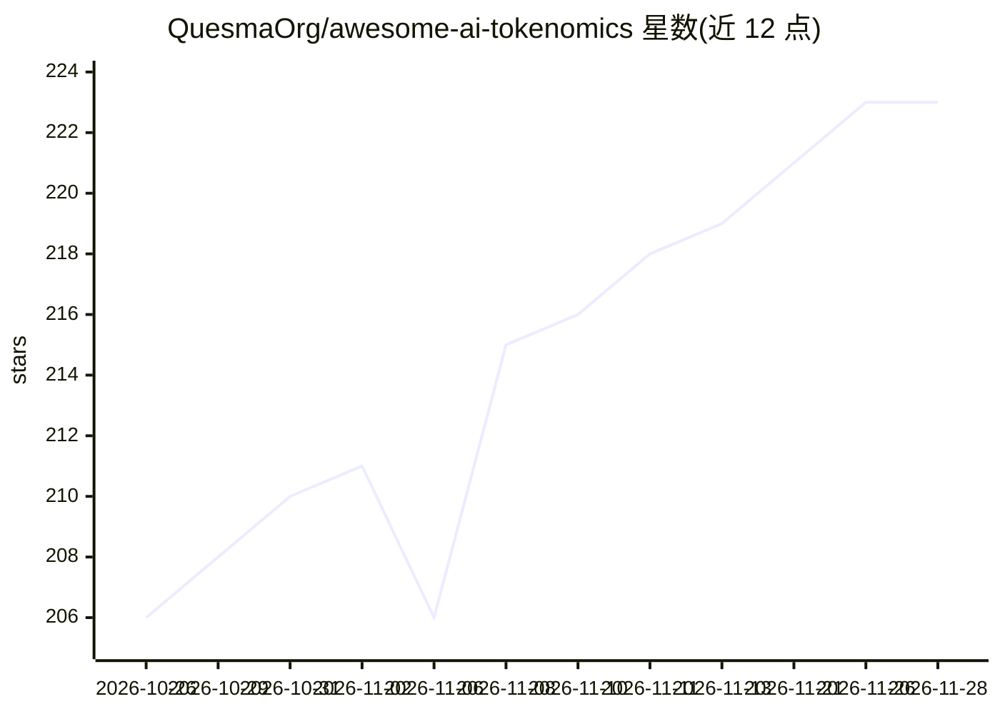

# QuesmaOrg/awesome-ai-tokenomics

⭐ 223 · Python · CC0-1.0 · 推送 2026-11-26 · [GitHub](https://github.com/QuesmaOrg/awesome-ai-tokenomics) · 组织维护

**面向 AI 开发者的 token 成本监测与优化资源清单**

收录 AI token 经济学的工具、论文、基准与厂商页面，按监控、优化、成本控制、网关代理等类别组织，覆盖用量仪表盘、缓存、上下文压缩、语义缓存、支出限额等子类。每个条目带类型徽章（工具含许可证与最近提交状态）、论文与数据集单独标记，另提供可直接复用的配置片段，服务对象是关注 LLM 与编码 agent 花费的开发者和团队。

## 筛选速览

| 维度 | 判定 | 备注 |
|---|---|---|
| AI 角色 | `ai-knowledge` | 知识聚合/清单类 |
| 许可风险 | `viral` | CC0-1.0 |
| 部署形态 | `None` |  |
| 模型依赖 | — | README 未给出锁定关系 |
| 硬件要求 | — | 无带数字的原话,不猜 |
| 安装摩擦 | `medium` | 含编译或系统依赖之一 |
| 成熟度 | — | 结构信号不足 |

## 能力要点

- 按 Monitor/Optimize/Cost Controls/Gateways 等场景分类组织条目
- 条目带类型徽章：tool/paper/bench/data/co/report，工具标注许可证
- 覆盖缓存、压缩、上下文工程、本地模型等具体降本手段
- 收录自托管与商业可观测性平台两类条目

## 适用场景

- 为编码 agent 选型用量与成本监控工具
- 查找上下文压缩或语义缓存方案来减少 token 消耗
- 了解 LLM 网关与支出限额的可用选项

## 场景标签

`精选清单` · 领域:学习与行业

## 证据(README 行号)

> L1: # Awesome AI Tokenomics Awesome
> L5: Tools, papers, benchmarks, and vendor pages on what AI tokens cost and where they go.
> L9: ### Legend

## 星数曲线

2026-10-26 206 → 2026-11-28 223（+17）

---
*卡片 v1 · prompt 1.4 · 生成 2026-11-25 · 置信度 high · 依据 README sha `cfb95c617074` · [字段定义](../../DATASET.md)*
