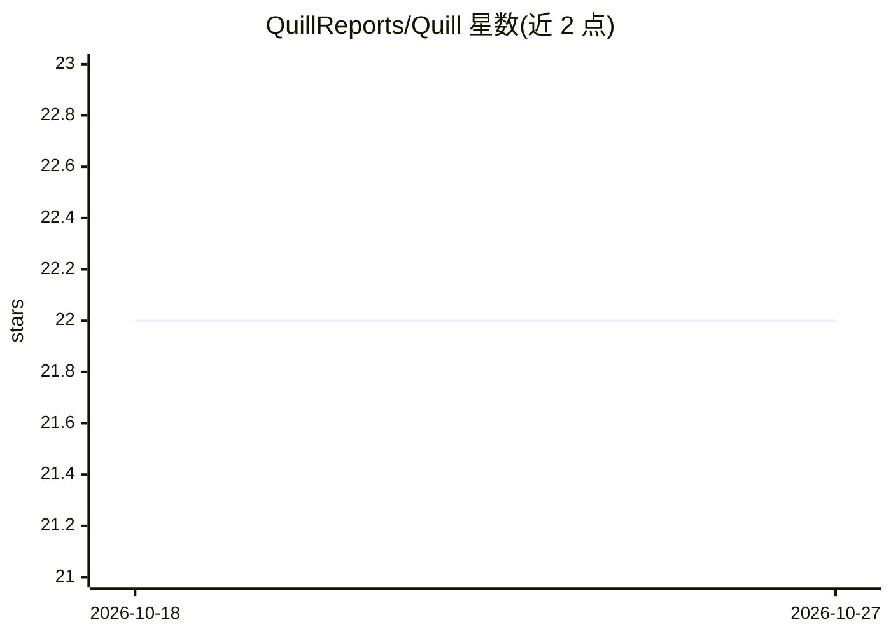

# QuillReports/Quill

⭐ 22 · TypeScript · MIT · 推送 2026-09-04 · [GitHub](https://github.com/QuillReports/Quill) · [官网](https://quillalpha.com/) · 组织维护

**面向 Robinhood 加密市场的 AI 研究报告写作者**

基于 Claude Agent SDK 构建的市场情报写作系统：从配置的数据源拉取代币价格、成交量、市值与板块数据，按选定报告类型（周度摘要/单资产深度/板块对比）填充具名章节，附来源可查的数据点，编译输出 markdown 或 JSON 报告。面向需要可复现研究产出的团队，用于发布引擎、内部备忘初稿或降低空白页问题。需配置 ANTHROPIC API key，通过 git clone 与 bun 运行，MIT 许可。

## 筛选速览

| 维度 | 判定 | 备注 |
|---|---|---|
| AI 角色 | `ai-native` | 本体是模型或模型工具 |
| 许可风险 | `permissive` | MIT |
| 部署形态 | `None` |  |
| 模型依赖 | locked-api |  |
| 硬件要求 | — | 无带数字的原话,不猜 |
| 安装摩擦 | `low` | 无编译、无系统依赖或容器化 |
| 成熟度 | — | 结构信号不足 |

## 能力要点

- 三类有界报告类型：weekly_digest / protocol_deep_dive / sector_overview
- 来源感知章节：数据点与来源说明附在对应论断旁
- 输出 markdown 供发布或 JSON 供下游系统消费
- 基于 Claude Agent SDK 构建

## 适用场景

- 团队周期性产出加密市场生态周报
- 把最新指标转成初稿备忘供分析师编辑
- 对比相关加密板块并产出带叙事的比较研究

## 场景标签

`AI 写作` · 领域:内容生成

## 证据(README 行号)

> L12: Built with Claude Agent SDK
> L171: ANTHROPIC_API_KEY=sk-ant-...

## 星数曲线

2026-10-18 22 → 2026-10-27 22（+0）

---
*卡片 v1 · prompt 1.4 · 生成 2026-10-27 · 置信度 high · 依据 README sha `ac19c8531a41` · [字段定义](../../DATASET.md)*
