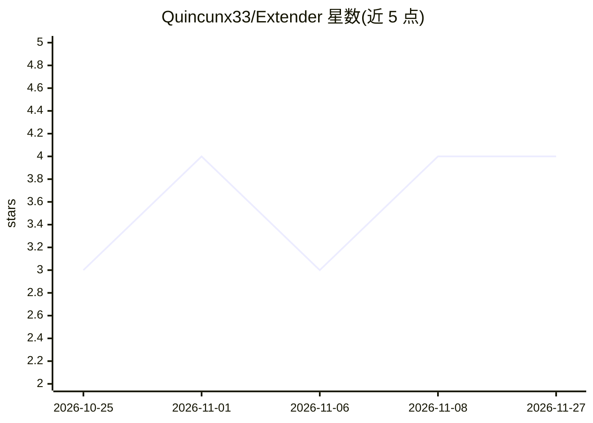

# Quincunx33/Extender

⭐ 4 · JavaScript · 推送 2026-10-17 · [GitHub](https://github.com/Quincunx33/Extender) · [官网](https://meawpromt.pages.dev) · 个人维护

**将粗略想法转写为可直接复制使用的 AI 提示词的 Web 工具**

一个提示词生成 Web 应用：用户输入想法（如习惯追踪器、创意视频构思），由服务端集成的 Gemini 将其转换为面向代码、图像、故事、视频等用途的结构化提示词。支持附加参考媒体作为上下文、历史记录与一键复制；API 密钥存于服务端环境变量而非浏览器端。提供在线演示站点，可本地运行或部署到 Cloudflare Pages。README 未说明模型配置选项，未提及除 Gemini 外的提供商。

## 筛选速览

| 维度 | 判定 | 备注 |
|---|---|---|
| AI 角色 | `ai-native` | 本体是模型或模型工具 |
| 许可风险 | `none` | — |
| 部署形态 | `library` | 以包/库形式分发 |
| 模型依赖 | — | README 未给出锁定关系 |
| 硬件要求 | — | 无带数字的原话,不猜 |
| 安装摩擦 | `low` | 无编译、无系统依赖或容器化 |
| 成熟度 | — | 结构信号不足 |

## 能力要点

- 将想法转换为可直接复制的 AI 提示词
- 支持附加参考媒体作为提示词上下文
- 历史记录与一键复制功能
- 服务端 Gemini 集成，API 密钥不暴露在浏览器

## 适用场景

- 把一个粗略的项目想法整理成给编码 AI 的指令
- 为图像/视频生成工具准备结构化提示词
- 保存和复用自己生成过的提示词

## 场景标签

`提示工程` · 领域:Agent 开发

## 证据(README 行号)

> L5: A little prompt architect that turns your thoughts into focused, copy-ready instructions for AI.
> L23: - **Server-side Gemini integration** to keep API credentials out of the browser.

## 星数曲线

2026-10-25 3 → 2026-11-27 4（+1）

---
*卡片 v1 · prompt 1.4 · 生成 2026-11-21 · 置信度 high · 依据 README sha `692d2bdc7fdd` · [字段定义](../../DATASET.md)*
