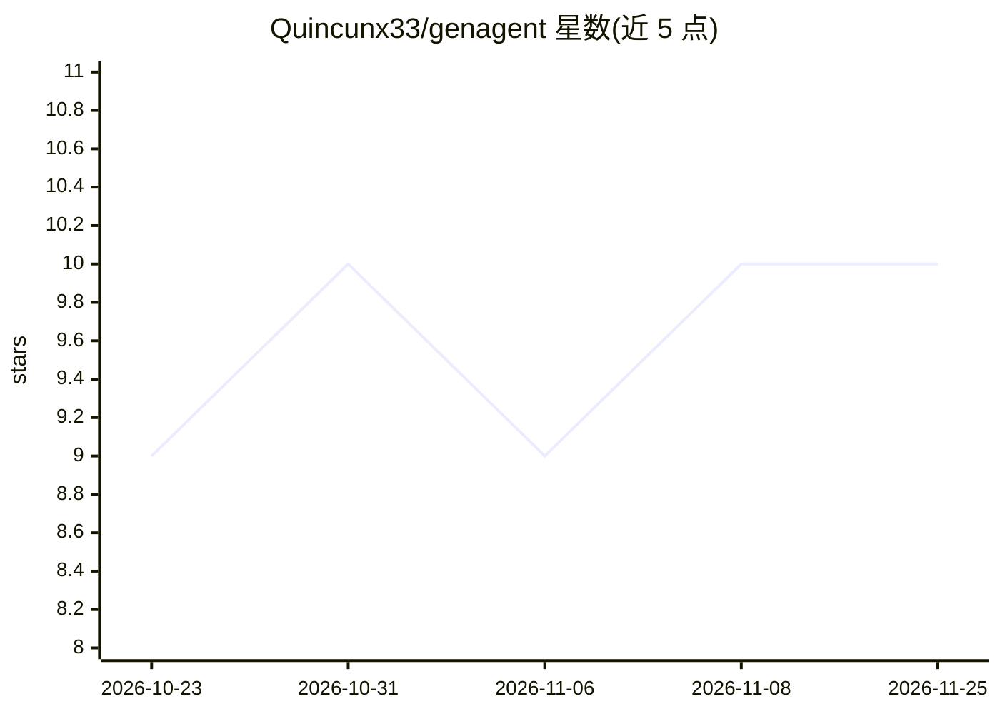

# Quincunx33/genagent

⭐ 10 · Python · MIT · 推送 2026-10-16 · [GitHub](https://github.com/Quincunx33/genagent) · 个人维护

**基于 Gemini 的本地终端自动化 agent，带安全沙箱**

一个仅依赖 Python 标准库的终端自主计算机助手，用于本地开发、编码与受控工作区自动化。通过 Gemini 模型执行 observe-plan-act-verify 循环，提供文件读写/补丁、命令执行、Python 验证、Git 检查点、图像理解等 14 个工具；内置工作区边界限制、命令风险分级、凭据脱敏与任务自我纠正机制。需配置 Gemini API key，支持交互式终端模式与无人值守的后台守护进程模式，MIT 许可。

## 筛选速览

| 维度 | 判定 | 备注 |
|---|---|---|
| AI 角色 | `ai-native` | 本体是模型或模型工具 |
| 许可风险 | `permissive` | MIT |
| 部署形态 | `None` |  |
| 模型依赖 | — | README 未给出锁定关系 |
| 硬件要求 | — | 无带数字的原话,不猜 |
| 安装摩擦 | `low` | 无编译、无系统依赖或容器化 |
| 成熟度 | — | 结构信号不足 |

## 能力要点

- 零第三方运行时依赖，纯 Python 3 标准库实现
- 14 个内置工具：文件补丁、命令执行、Git 检查点、Gemini Vision 图像理解
- 命令风险四级分类（Normal/Low Risk/Privileged/Destructive）与凭据自动脱敏
- 动态任务规划与工具错误后的替代恢复步骤

## 适用场景

- 在本地工作区让 AI agent 代为执行编码与文件修改任务
- 无人值守地定时运行后台自动化任务
- 对大型文件做精准片段替换而避免整文件重写

## 场景标签

`编码 Agent` · 领域:编码与开发

## 证据(README 行号)

> L11: `genagent` is a dependency-free, terminal-based autonomous computer assistant for local development, coding, and co
> L18: - **Dynamic Task Planning & Self-Correction:** Tracks step progression (`[DONE]`, `[ACTIVE]`, `[PENDING]`), detects
> L20: - **Bounded Safety & Workspace Sandboxing:** Strict workspace boundaries, command risk classification (Normal, Low 

## 星数曲线

2026-10-23 9 → 2026-11-25 10（+1）

---
*卡片 v1 · prompt 1.4 · 生成 2026-11-20 · 置信度 high · 依据 README sha `9d3d9ee48396` · [字段定义](../../DATASET.md)*
