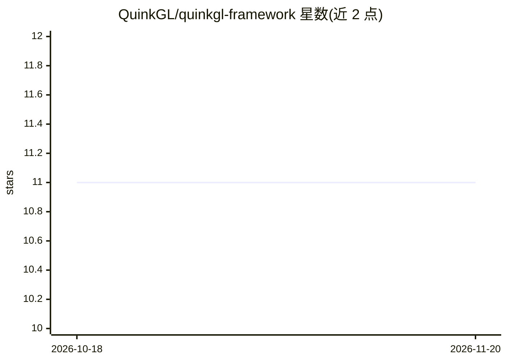

# QuinkGL/quinkgl-framework

⭐ 11 · Python · Apache-2.0 · 推送 2026-08-02 · [GitHub](https://github.com/QuinkGL/quinkgl-framework) · [官网](https://quinkgl.com) · 组织维护

**面向分布式设备的去中心化 P2P gossip 联邦学习框架**

基于 gossip 协议的去中心化联邦学习 Python 框架，无需中心参数服务器即可在分布式节点间协作训练模型。内置可插拔的拓扑策略（随机、环、小世界、数据感知亲和等 8 种）与聚合策略（FedAvg/FedProx/SCAFFOLD/Krum/TrimmedMean 等），通过隐私保护指纹实现数据感知的对等节点选择，带误差反馈压缩管线、拜占庭容错、NAT 穿透与 .qgl swarm 清单机制。提供 CLI 与 Python API，支持 PyTorch/TensorFlow 模型封装。需 Python 3.10+。

## 筛选速览

| 维度 | 判定 | 备注 |
|---|---|---|
| AI 角色 | `ai-native` | 本体是模型或模型工具 |
| 许可风险 | `permissive` | Apache-2.0 |
| 部署形态 | `library` | 以包/库形式分发 |
| 模型依赖 | — | README 未给出锁定关系 |
| 硬件要求 | — | 无带数字的原话,不猜 |
| 安装摩擦 | `low` | 无编译、无系统依赖或容器化 |
| 成熟度 | — | 结构信号不足 |

## 能力要点

- 可插拔拓扑策略（Random/Cyclon/Affinity/Ring/SmallWorld 等）与运行时谱分析（λ₂、谱间隙）
- 8 种可热插拔聚合策略，含 Krum/MultiKrum/TrimmedMean 拜占庭容错
- 隐私保护数据指纹驱动的 AffinityTopology 同类节点匹配
- Delta→Sparsify→Quantize 压缩管线加误差反馈机制

## 适用场景

- 在没有中心服务器的边缘节点间协作训练模型
- 在 non-IID 数据分布下做去中心化学习实验
- 研究拜占庭容错与拓扑选择对 gossip 收敛的影响

## 场景标签

`模型训练` · 领域:训练与推理

## 证据(README 行号)

> L7: **QuinkGL** is a fully **decentralized, peer-to-peer (P2P) federated learning framework** that enables collaborative
> L25: |**Non-IID Resilient**|AffinityTopology + EntropyWeightedAvg + FedProx + SCAFFOLD for heterogeneous data|

## 星数曲线

2026-10-18 11 → 2026-11-20 11（+0）

---
*卡片 v1 · prompt 1.4 · 生成 2026-11-18 · 置信度 high · 依据 README sha `020b2a7e9c1c` · [字段定义](../../DATASET.md)*
