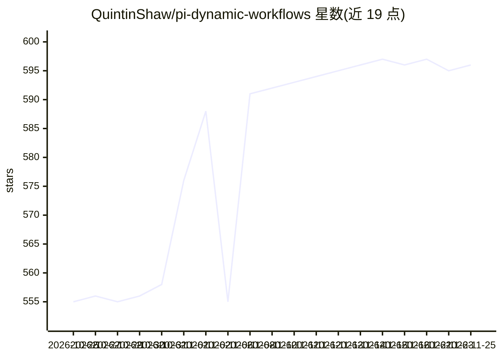

# QuintinShaw/pi-dynamic-workflows

⭐ 596 · TypeScript · MIT · 推送 2026-11-22 · [GitHub](https://github.com/QuintinShaw/pi-dynamic-workflows) · [官网](https://quintinshaw.github.io/pi-dynamic-workflows/) · 个人维护

**Pi 编码 agent 的动态多子代理编排扩展包**

面向 Pi 编码代理的扩展：将一个提示编译为确定性的 JavaScript 编排脚本，向最多 16 个并发子代理分发任务，按 small/medium/big 分层或指定 provider/model 路由，支持 git worktree 分支隔离、中断后按日志回放已完成的 agent、逐会话 token 与成本核算，并提供 /workflows 交互面板、关键词触发、5 个内置工作流（/deep-research、/code-review 等）与 /ultracode 常驻模式。通过 npm 以 pi-package 形式安装。

## 筛选速览

| 维度 | 判定 | 备注 |
|---|---|---|
| AI 角色 | `ai-ecosystem` | LLM/agent 周边工具 |
| 许可风险 | `permissive` | MIT |
| 部署形态 | `library` | 以包/库形式分发 |
| 模型依赖 | — | README 未给出锁定关系 |
| 硬件要求 | — | 无带数字的原话,不猜 |
| 安装摩擦 | `low` | 无编译、无系统依赖或容器化 |
| 成熟度 | — | 结构信号不足 |

## 能力要点

- agent()/parallel()/pipeline() 等 20 余个编排 API 生成确定性 JS 脚本
- 日志化 resume：编辑脚本后未变更的 agent 调用从缓存回放
- git worktree 隔离与逐会话 token/成本计量
- /workflows TUI、关键词触发与 5 个内置工作流模式

## 适用场景

- 对整个代码库做权限缺失等审计类大范围检查
- 多视角代码评审与大型重构
- 带来源核查的研究问题检索
- 中断后按预算恢复续跑长任务编排

## 场景标签

`多智能体` `编码 Agent` `代码审查` `科研工具` · 领域:Agent 开发

## 证据(README 行号)

> L11: Turn one request into a JavaScript orchestration script that fans work out across isolated subagents, routes each t
> L53: - **Per-agent model routing** — use `small`, `medium`, or `big` tiers, or choose an exact provider/model and thinki

## 星数曲线

2026-10-25 555 → 2026-11-25 596（+41）

---
*卡片 v1 · prompt 1.4 · 生成 2026-11-25 · 置信度 high · 依据 README sha `31714cd919b1` · [字段定义](../../DATASET.md)*
