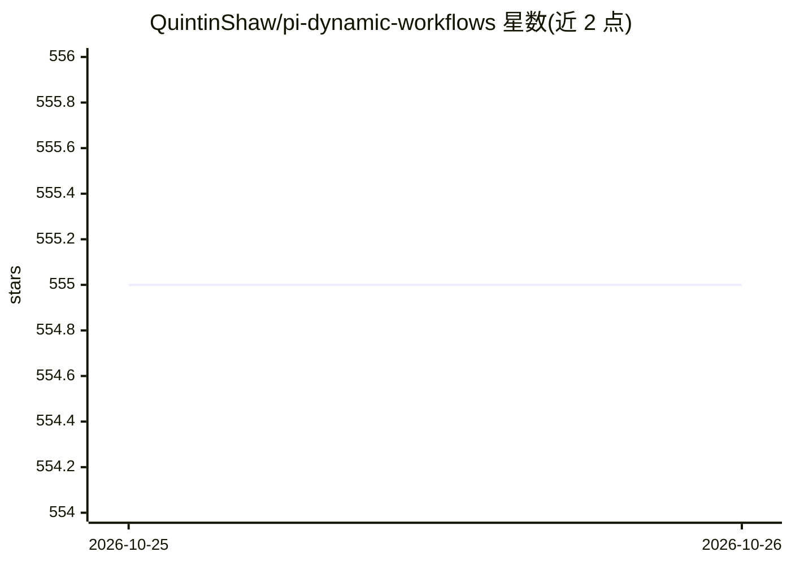

# QuintinShaw/pi-dynamic-workflows

⭐ 555 · TypeScript · MIT · 推送 2026-10-06 · [GitHub](https://github.com/QuintinShaw/pi-dynamic-workflows) · [官网](https://quintinshaw.github.io/pi-dynamic-workflows/) · 个人维护

**面向 Pi 编码助手的动态多子代理工作流编排扩展**

Pi（coding agent）的包，把单个提示转化为确定性 JavaScript 编排脚本：用 agent()/parallel()/pipeline() 等原语将任务扇出到隔离的子代理会话，按 small/medium/big 层级或具体 provider/model 做逐代理模型路由，支持 git worktree 隔离、journaled 断点续跑（未变更调用从缓存重放）、token 与成本核算，以及 /workflows 交互式运行导航器。内置 deep-research、adversarial-review、code-review 等工作流，可用 /ultracode 开启常驻模式。目标用户是在 Pi 中处理代码库级审计、大重构与多视角评审的开发者。限制：作为 Pi 扩展运行，依赖 Pi 环境；并发上限 16、单次最多 1000 个子代理。

## 筛选速览

| 维度 | 判定 | 备注 |
|---|---|---|
| AI 角色 | `ai-ecosystem` | LLM/agent 周边工具 |
| 许可风险 | `permissive` | MIT |
| 部署形态 | `library` | 以包/库形式分发 |
| 模型依赖 | — | README 未给出锁定关系 |
| 硬件要求 | — | 无带数字的原话,不猜 |
| 安装摩擦 | `low` | 无编译、无系统依赖或容器化 |
| 成熟度 | — | 结构信号不足 |

## 能力要点

- 单编排脚本最多扇出 16 并发、1000 个子代理
- 逐代理模型路由（tier 或精确 provider/model/thinking）
- Journaled resume：中断后按最长未变前缀从缓存重放，支持编辑后续跑
- git worktree 隔离与逐代理 token/成本核算，未上报用量以 ~ 前缀标注启发式估计
- 内置 deep-research / adversarial-review / code-review 等 5 种可复用工作流

## 适用场景

- 对代码库做超出单上下文窗口的全库审计或多视角评审
- 大型重构中并行调度子代理并隔离分支修改
- 带引用溯源的深度研究任务
- 中断后从已完成代理处续跑，避免重复消耗 token

## 场景标签

`多智能体` `Agent 框架` · 领域:Agent 开发

## 证据(README 行号)

> L5:  Built for Pi
> L11: Turn one request into a JavaScript orchestration script that fans work out across isolated subagents, routes each t
> L37: 1. **Orchestrate** — Pi writes a deterministic JavaScript workflow with `agent()`, `parallel()`, `pipeline()`, and 
> L38: 2. **Fan out** — fresh subagent sessions run concurrently, optionally on different models or isolated git worktrees

## 星数曲线

2026-10-25 555 → 2026-10-26 555（+0）

---
*卡片 v1 · prompt 1.4 · 生成 2026-10-24 · 置信度 high · 依据 README sha `7b48a68fcc06` · [字段定义](../../DATASET.md)*
