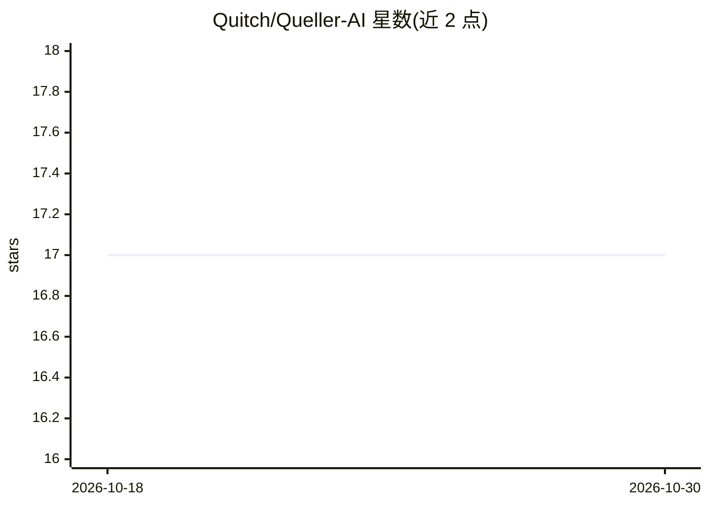

# Quitch/Queller-AI

⭐ 17 · JavaScript · CC-BY-4.0 · 推送 2026-10-17 · [GitHub](https://github.com/Quitch/Queller-AI) · [官网](https://forums.planetaryannihilation.com/threads/rel-server-queller-ai.65795/) · 个人维护

**Planetary Annihilation: TITANS 的游戏 AI 全面重制模组**

针对 Planetary Annihilation: TITANS 的 AI 总体重制模组，旨在平滑难度曲线，提供比原版 AI 更易与更难、更拟人的挑战，并完整支持 Legion 扩展。提供 Casual 至 Uber 六档难度与十种可定制子人格（1v1、空军、Rush、Turtle 等），附原版难度对照与按天梯段位的难度推荐。需通过游戏内 Community Mods 安装；Galactic War 模式需另装 Galactic War Overhaul。README 列出多项 CANTFIX/WONTFIX 已知问题，贡献者文档在 docs/ 目录。

## 筛选速览

| 维度 | 判定 | 备注 |
|---|---|---|
| AI 角色 | `ai-native` | 本体是模型或模型工具 |
| 许可风险 | `viral` | CC-BY-4.0 |
| 部署形态 | `None` |  |
| 模型依赖 | — | README 未给出锁定关系 |
| 硬件要求 | — | 无带数字的原话,不猜 |
| 安装摩擦 | `low` | 无编译、无系统依赖或容器化 |
| 成熟度 | — | 结构信号不足 |

## 能力要点

- 六档难度（Casual/Bronze/Silver/Gold/Platinum/Uber）模拟不同水平人类玩家
- 十种子人格定制战术风格（1v1、Air、Bot、Rush、Turtle 等）
- 完整支持 Legion 扩展，已随 PA 官方收录
- 提供原版难度对照表与天梯段位对应的难度推荐

## 适用场景

- 单人战役中寻找比原版更拟人的 AI 对手
- 按自己天梯段位选择合适难度的 AI 练习
- 通过子人格定制 AI 的战术风格

## 场景标签

 · 领域:游戏/RTS 模组

## 证据(README 行号)

> L5: Improved AI for Planetary Annihilation: TITANS. This mod is now included in PA.
> L7: This mod is a total overhaul of the AI designed to smooth out the difficulty curve, providing more humanlike challen

## 星数曲线

2026-10-18 17 → 2026-10-30 17（+0）

---
*卡片 v1 · prompt 1.4 · 生成 2026-10-30 · 置信度 high · 依据 README sha `dd9fc746ba4f` · [字段定义](../../DATASET.md)*
