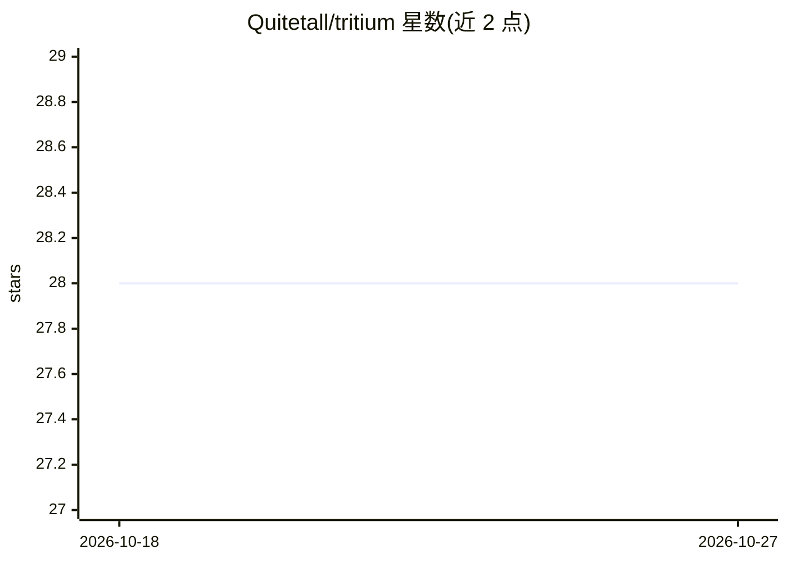

# Quitetall/tritium

⭐ 28 · Rust · Apache-2.0 · 推送 2026-10-26 · [GitHub](https://github.com/Quitetall/tritium) · [官网](https://docs.rs/tritium-core) · 个人维护

**三值（{-1,0,+1}）模型的训练与推理基础设施库**

Apache-2.0 许可的 Rust 基础设施库，把稠密神经网络转换为紧凑加性三值模型，支持 PyTorch 后训练量化（1-3 个三值平面、校准收据、物理字节核算）与可微 QAT（STE 估计器、Hugging Face 集成），并在 CPU、CUDA、Metal、ROCm、wgpu、WASM 等多种运行时上执行打包权重，另含 OpenAI 兼容 serving。当前为 1.1.0-rc.2 候选版本，多项发布门禁未通过，公共构件未激活，仅可从 crates.io 安装预发布版或源码构建。

## 筛选速览

| 维度 | 判定 | 备注 |
|---|---|---|
| AI 角色 | `ai-ecosystem` | LLM/agent 周边工具 |
| 许可风险 | `permissive` | Apache-2.0 |
| 部署形态 | `library` | 以包/库形式分发 |
| 模型依赖 | — | README 未给出锁定关系 |
| 硬件要求 | `cpu-ok` | |
| 安装摩擦 | `medium` | 含编译或系统依赖之一 |
| 成熟度 | `idea` | |

## 能力要点

- 加性 PTQ：1-3 个三值平面、校准收据、严格物理字节核算
- 可微 PyTorch QAT，含 STE 估计器与 Hugging Face 集成
- 多运行时打包推理内核：CPU/CUDA/Metal/ROCm/wgpu/WASM/浏览器 WebGPU 等
- OpenAI 兼容 serving，含认证、就绪探针、指标与 Kubernetes 资产

## 适用场景

- 把 BitNet 类三值模型量化、打包并在 CPU/CUDA 上推理
- 对三值模型做 QAT 训练与质量诊断
- 以收据与证据登记的形式管理模型工件生命周期

## 场景标签

`推理引擎` `模型量化` · 领域:训练与推理

## 证据(README 行号)

> L15: Tritium is Apache-2.0 infrastructure for converting dense neural networks into
> L16: compact additive-ternary models, refining or training them with PyTorch, and
> L51: - Packed inference kernels and runtime adapters for CPU, CUDA, Metal, ROCm,

## 星数曲线

2026-10-18 28 → 2026-10-27 28（+0）

---
*卡片 v1 · prompt 1.4 · 生成 2026-10-26 · 置信度 high · 依据 README sha `e016f8eadc59` · [字段定义](../../DATASET.md)*
