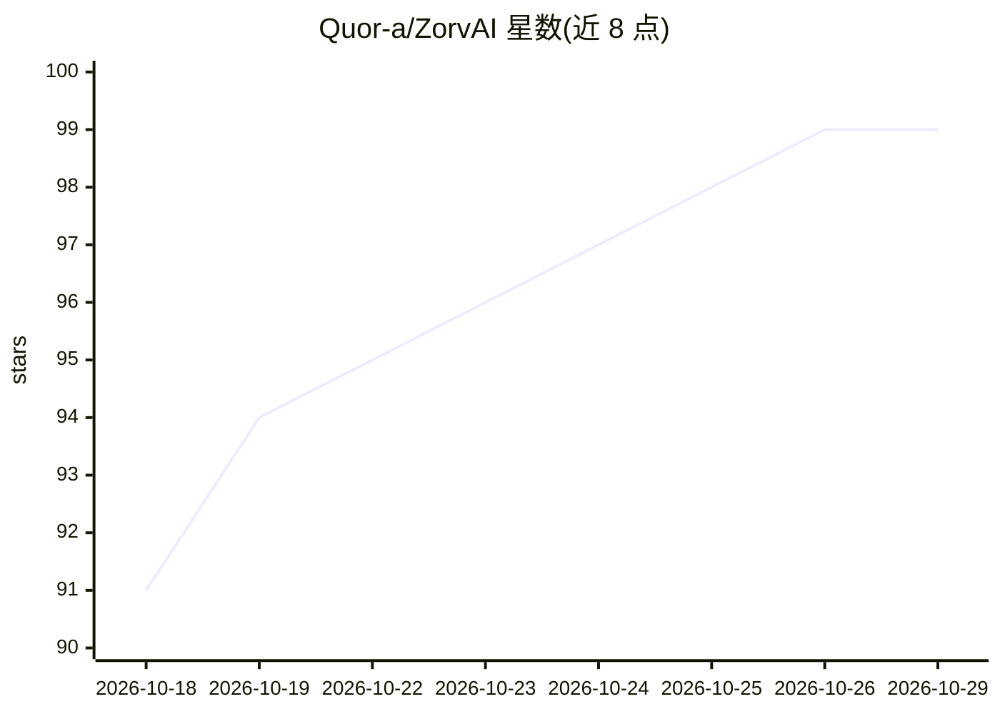

# Quor-a/ZorvAI

⭐ 99 · Kotlin · NOASSERTION · 推送 2026-10-27 · [GitHub](https://github.com/Quor-a/ZorvAI) · [官网](https://github.com/Quor-a/ZorvAI/releases) · 个人维护 · 中文 README

**Android 设备端 AI Agent 助手：离线推理、235 工具操控手机**

Kotlin + Jetpack Compose 开发的安卓端 AI 智能体应用：设备上运行 MNN / llama.cpp 离线大模型，通过无障碍 / Shizuku / ROOT / 应用内 Linux（proot）等 L1–L5 分级特权通道操控系统，内置 235 个工具、四类记忆、RAG 知识库、多供应商 TTS 与端侧流式 STT，并支持飞书 / QQ / 微信接入与 APK 级插件扩展。采用 Tool-first 注册表设计，任务经策划→ReAct 执行→交付闸门闭环驱动。需 Android 8.0+，从源码构建需 JDK 17+ 与 NDK。

## 筛选速览

| 维度 | 判定 | 备注 |
|---|---|---|
| AI 角色 | `ai-native` | 本体是模型或模型工具 |
| 许可风险 | `none` | NOASSERTION |
| 部署形态 | `None` |  |
| 模型依赖 | — | README 未给出锁定关系 |
| 硬件要求 | — | 无带数字的原话,不猜 |
| 安装摩擦 | `medium` | 含编译或系统依赖之一 |
| 成熟度 | — | 结构信号不足 |

## 能力要点

- MNN / llama.cpp 离线推理引擎编译进 APK，断网可用
- 235 个内置工具 + L1–L5 分级特权执行，未授权返回引导文案
- 内置 proot Ubuntu 24.04 / LANXIU 双 Linux 沙箱终端
- APK 级插件框架，14 种扩展点无需改宿主代码

## 适用场景

- 让 AI 在手机上替我执行读屏、点按、文件与定时任务
- 断网环境下使用本地大模型对话与工具调用
- 通过飞书 / QQ / 微信远程与 AI 助手交互
- 在手机终端里跑 Ubuntu Linux 环境

## 场景标签

`AI 助手` `GUI 自动化` `聊天机器人` · 领域:效率与自动化

## 证据(README 行号)

> L5: ### 运行在 Android 上的设备端 AI Agent · 智能体助手
> L56: > Zorv AI 把「对话助手」做成一个真正能操作手机的 Agent：它在设备上运行，能用无障碍 / Shizuku / ROOT 等通道操控系统，调用 **235 个内置工具**，运行 **MNN / llama.cpp 离线

## 星数曲线

2026-10-18 91 → 2026-10-29 99（+8）

---
*卡片 v1 · prompt 1.4 · 生成 2026-10-23 · 置信度 high · 依据 README sha `d92193eeb00c` · [字段定义](../../DATASET.md)*
