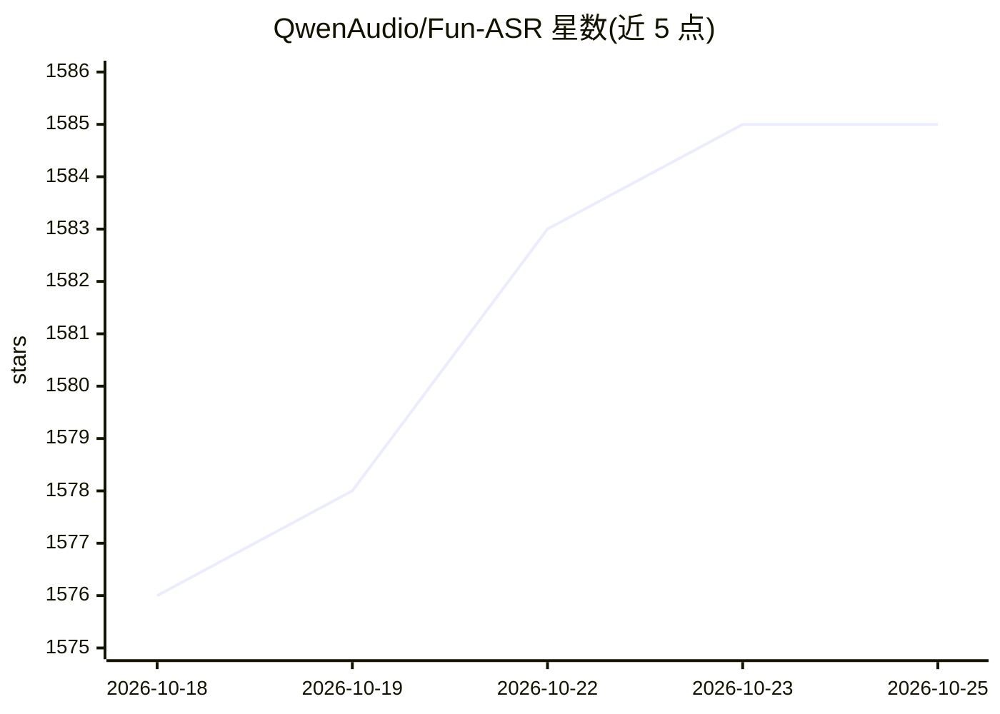

# QwenAudio/Fun-ASR

⭐ 1,586 · C · Apache-2.0 · 推送 2026-10-12 · [GitHub](https://github.com/QwenAudio/Fun-ASR) · [官网](https://huggingface.co/spaces/FunAudioLLM/Fun-ASR-Nano) · 组织维护 · 中文 README

**通义实验室的多语言语音识别模型家族（800M，含中文方言）**

来自 Tongyi Lab 的端到端语音识别模型仓库：Fun-ASR-Nano-2512（800M，数千万小时训练，中/英/日及 7 大方言、26 地方口音）与 Fun-ASR-MLT-Nano-2512（800M，31 语言）。模型本身经 Hugging Face Transformers、FunASR 工具包、vLLM（批式/流式/WebSocket 服务）及 llama.cpp GGUF 单二进制（CPU/边缘，无 Python 运行时）多路径部署。说话人分离需与 fsmn-vad、cam++ 组合实现；仓库不含模型权重本体，另提供微调文档。

## 筛选速览

| 维度 | 判定 | 备注 |
|---|---|---|
| AI 角色 | `ai-native` | 本体是模型或模型工具 |
| 许可风险 | `permissive` | Apache-2.0 |
| 部署形态 | `library` | 以包/库形式分发 |
| 模型依赖 | local-ok | 支持本地模型 |
| 硬件要求 | — | 无带数字的原话,不猜 |
| 安装摩擦 | `medium` | 含编译或系统依赖之一 |
| 成熟度 | — | 结构信号不足 |

## 能力要点

- 两个 800M 检查点：中英日+方言版与 31 语言多语版
- 原生支持 Transformers 5.17.0 直接推理，无需工具包
- vLLM 高吞吐路径：批式/流式 SDK/WebSocket 服务，README 报告 RTFx 340x
- llama.cpp/GGUF 单二进制可在 CPU/边缘运行，内置 FSMN-VAD

## 适用场景

- 我用它转写含中文方言和地方口音的录音
- 部署实时字幕或流式转写 WebSocket 服务
- 在无 GPU 的边缘设备上离线转写音频
- 批量转写大量多语言音频文件

## 场景标签

`语音识别` · 领域:感知与多模态

## 证据(README 行号)

> L5: Fun-ASR is a family of end-to-end speech recognition models from Tongyi Lab. Checkpoint capabilities are distinct: F
> L52: **Fun-ASR** focuses on high-precision speech recognition, checkpoint-specific multilingual support, and industry cu

## 星数曲线

2026-10-18 1,576 → 2026-10-25 1,585（+9）

---
*卡片 v1 · prompt 1.4 · 生成 2026-10-21 · 置信度 high · 依据 README sha `a33801132f9c` · [字段定义](../../DATASET.md)*
