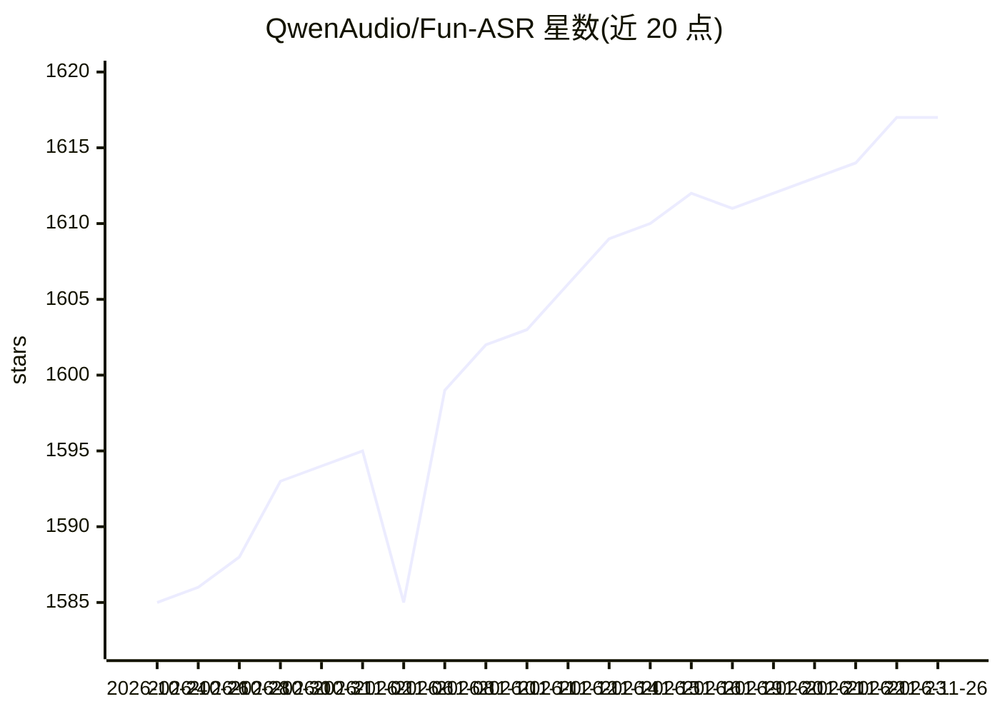

# QwenAudio/Fun-ASR

⭐ 1,617 · C · Apache-2.0 · 推送 2026-11-20 · [GitHub](https://github.com/QwenAudio/Fun-ASR) · [官网](https://huggingface.co/spaces/FunAudioLLM/Fun-ASR-Nano) · 组织维护 · 中文 README

**面向开发者/企业的端到端语音识别模型家族 Fun-ASR**

通义实验室的端到端语音识别模型集合：Fun-ASR-Nano-2512（800M）支持中英日及 7 种方言、26 种地区口音；Fun-ASR-MLT-Nano-2512（800M）支持 31 种语言。提供四条推理路径：Hugging Face Transformers 原生加载、FunASR Python 推理、vLLM 批量/流式/WebSocket 服务、llama.cpp/GGUF 单二进制 CPU 运行。自带 CTC 字符时间戳（特定 checkpoint），说话人分离需与 fsmn-vad、cam++ 组合实现。支持微调，文档指向 docs/finetune.md。

## 筛选速览

| 维度 | 判定 | 备注 |
|---|---|---|
| AI 角色 | `ai-native` | 本体是模型或模型工具 |
| 许可风险 | `permissive` | Apache-2.0 |
| 部署形态 | `library` | 以包/库形式分发 |
| 模型依赖 | local-ok | 支持本地模型 |
| 硬件要求 | — | 无带数字的原话,不猜 |
| 安装摩擦 | `medium` | 含编译或系统依赖之一 |
| 成熟度 | — | 结构信号不足 |

## 能力要点

- 两个 800M checkpoint：中英日+方言口音、31 语种
- Transformers 原生支持，无需额外工具包或远程代码
- llama.cpp/GGUF 路径无需 GPU 与 Python，运行时内置 FSMN-VAD
- vLLM 批量/流式/WebSocket 三种部署模式

## 适用场景

- 会议、车载、工业现场等远场高噪声场景转写
- 中文方言与地区口音语音识别
- 31 语种多语言音频转写
- 实时字幕与 WebSocket 流式识别服务

## 场景标签

`语音识别` `微调` · 领域:感知与多模态

## 证据(README 行号)

> L5: Fun-ASR is a family of end-to-end speech recognition models from Tongyi Lab. Checkpoint capabilities are distinct: F
> L24: |Fun-ASR-Nano (⭐ HF / Transformers · HF / FunASR)|Speech recognition supports Chinese, English, and Japanese. Chine
> L154: Fun-ASR natively integrates the vLLM engine for high-throughput batch inference and production-grade real-time str

## 星数曲线

2026-10-24 1,585 → 2026-11-26 1,617（+32）

---
*卡片 v1 · prompt 1.4 · 生成 2026-11-23 · 置信度 high · 依据 README sha `f3dba6e9d902` · [字段定义](../../DATASET.md)*
