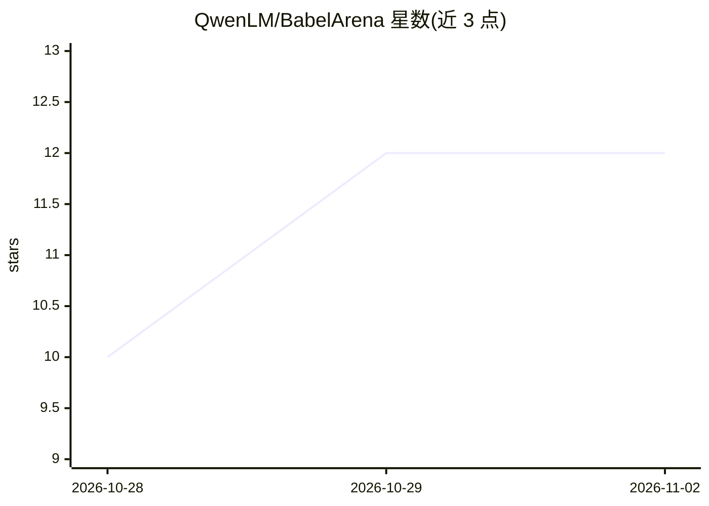

# QwenLM/BabelArena

⭐ 12 · Python · NOASSERTION · 推送 2026-10-23 · [GitHub](https://github.com/QwenLM/BabelArena) · 组织维护 · 中文 README

**覆盖 23 种语言的大规模 LLM Agent 多语言评测基准**

由 QwenLM 团队发布的 LLM Agent 多语言基准：将来自 VitaBench、DeepPlanning、τ³-Bench、ClawEval 四个基准家族的 699 个规范任务适配为 23 种语言共 16,077 个任务实例，覆盖 13 个领域，每种语言保留原任务身份与评测标准。语言变体由 BabelFlow 工作流生成并经多层验证与人工审核。每任务运行三次独立试验，报告 Pass^1、Pass^3 与语言一致性 LC。运行需 Python 3.12 与 3.10（或 3.11）、Docker（ClawEval 沙箱），任务数据约 14 GB 从 Hugging Face 或 ModelScope 单独下载，评测通过 ./bench 脚本执行，被测模型经 OpenAI 兼容端点接入。

## 筛选速览

| 维度 | 判定 | 备注 |
|---|---|---|
| AI 角色 | `ai-knowledge` | 知识聚合/清单类 |
| 许可风险 | `none` | NOASSERTION |
| 部署形态 | `library` | 以包/库形式分发 |
| 模型依赖 | — | README 未给出锁定关系 |
| 硬件要求 | — | 无带数字的原话,不猜 |
| 安装摩擦 | `low` | 无编译、无系统依赖或容器化 |
| 成熟度 | — | 结构信号不足 |

## 能力要点

- 699 个任务适配为 23 种语言共 16,077 个实例，覆盖 13 个领域
- 每任务三次独立试验，分别报告 Pass^1/Pass^3 与语言一致性 LC
- BabelFlow 工作流生成语言变体，经多层验证与人工审核
- 四类互补 Agent 场景：交互服务、长程规划、知识约束工具使用、异构自主任务

## 适用场景

- 评测 LLM Agent 在不同资源层级语言下的任务成功率
- 分析低资源语言场景下的工具使用错误与 token 开销差异
- 多语言 Agent 能力的可复现学术对比实验

## 场景标签

`模型评测` · 领域:评测与运维

## 证据(README 行号)

> L12: **BabelArena** is a multilingual benchmark for LLM agents: **699 canonical
> L24: Evaluating five frontier models, we find that no single model leads across all

## 星数曲线

2026-10-28 10 → 2026-11-02 12（+2）

---
*卡片 v1 · prompt 1.4 · 生成 2026-11-01 · 置信度 mid · 依据 README sha `e742a2543d7e` · [字段定义](../../DATASET.md)*
