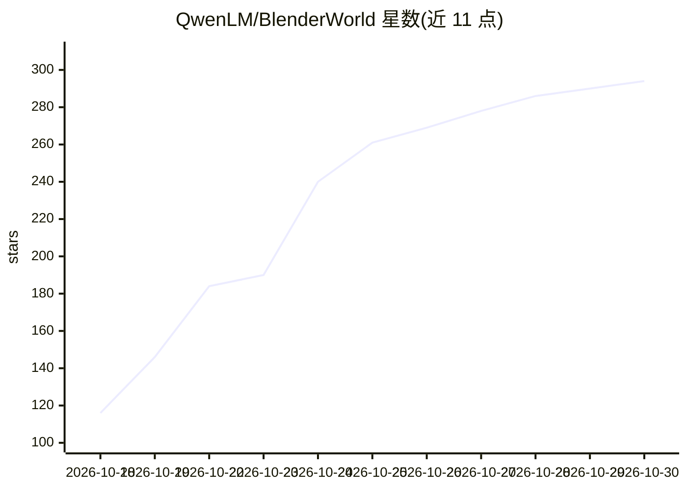

# QwenLM/BlenderWorld

⭐ 294 · Python · MIT · 推送 2026-10-20 · [GitHub](https://github.com/QwenLM/BlenderWorld) · 组织维护 · 中文 README

**评测视觉 agent 从真实参考生成 Blender 3D 场景的基准**

BlenderWorld 是一个 3D 创建基准：包含 223 个任务（9 大类 22 子类、2,651 条二元评判标准），任务输入为文本、图文或视频参考，agent 需交付可编辑的 Blender 工程及导出物。提供 bw 命令行工具完成数据集下载校验、工作区准备、提交打包与评测；评测流水线结合 8 个自适应视角渲染、场景检查、rubric 评分与 VLM 视觉质量评分（各占 50%），需要 Blender 4.2.10、Node.js、ffmpeg 及 Claude Code CLI 与视觉模型端点。可选接入 Harbor 作为生成与验证适配器。

## 筛选速览

| 维度 | 判定 | 备注 |
|---|---|---|
| AI 角色 | `ai-ecosystem` | LLM/agent 周边工具 |
| 许可风险 | `permissive` | MIT |
| 部署形态 | `library` | 以包/库形式分发 |
| 模型依赖 | — | README 未给出锁定关系 |
| 硬件要求 | — | 无带数字的原话,不猜 |
| 安装摩擦 | `medium` | 含编译或系统依赖之一 |
| 成熟度 | — | 结构信号不足 |

## 能力要点

- 223 个任务、2,651 条二元评判标准，覆盖产品/建筑/角色/动画等 9 类
- bw CLI 覆盖下载、校验、准备、打包与评测全流程
- 评测结合 8 自适应视角渲染（Cycles 1024×1024×64 采样）、Agent-as-Judge 与 VLM 评分
- 接受任意生成框架的提交，Harbor 集成为可选适配器

## 适用场景

- 评测视觉 agent 依据文本/图像/视频参考生成 3D 场景的能力
- 为 3D 生成 agent 的研发提供带 rubric 的可复现基准
- 对比不同 agent 在 Blender 建模任务上的表现

## 场景标签

`模型评测` `多模态` · 领域:评测与运维

## 证据(README 行号)

> L20: BlenderWorld evaluates agents on realistic 3D creation requests in Blender. Agents receive a task brief, reference 
> L24: BlenderWorld contains **223 tasks and 2,651 binary criteria**, spanning products, architecture, environments, chara

## 星数曲线

2026-10-18 116 → 2026-10-30 294（+178）

---
*卡片 v1 · prompt 1.4 · 生成 2026-10-22 · 置信度 high · 依据 README sha `1e57d6f7cf9f` · [字段定义](../../DATASET.md)*
