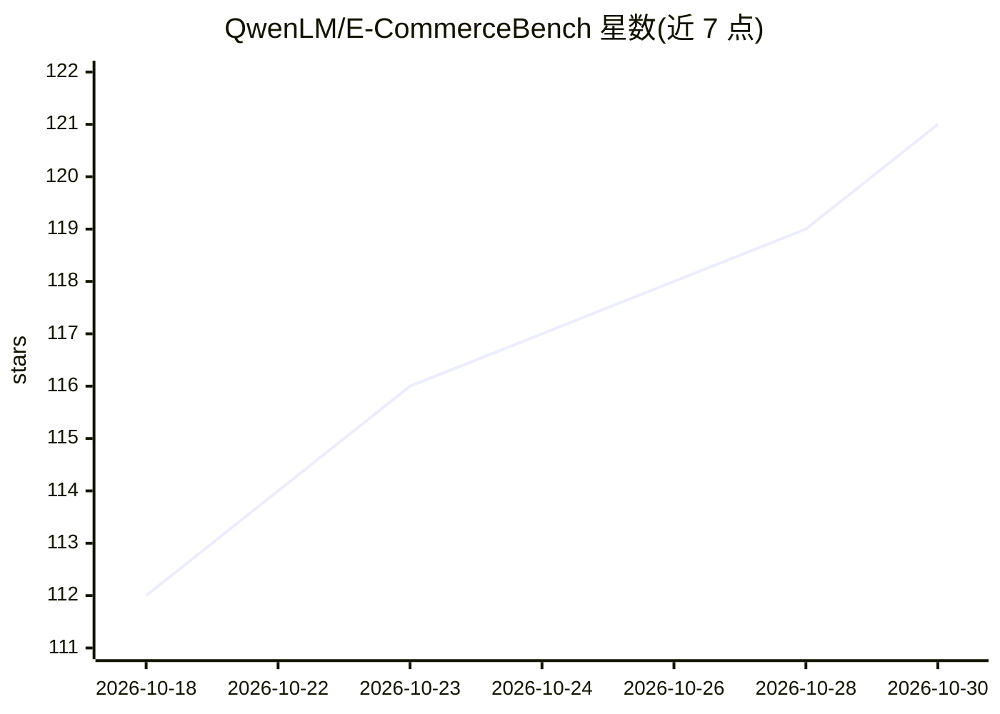

# QwenLM/E-CommerceBench

⭐ 121 · Python · Apache-2.0 · 推送 2026-09-13 · [GitHub](https://github.com/QwenLM/E-CommerceBench) · [官网](https://ecbench.github.io/) · 组织维护 · 中文 README

**评测 LLM Agent 长周期自主经营电商业务的基准**

由 QwenLM 团队发布的基准环境：LLM Agent 以 ¥100,000 起始资金在真实电商脱敏数据上运营最多四家网店 365 个模拟日，涵盖供应商谈判、定价、库存与现金流管理，按年末资产倍数及谈判、防欺诈、偿付等维度评分。市场供需两侧均为确定性：需求来自 6,886 商品的固定多因子模型，576 家供应商中 152 家含五种欺诈模式；供应商 NPC 由独立模型渲染对白但不可改价。提供 Python 实现，pip 安装依赖并配置 API key 后用 run.py 运行，支持并行 5 回合评测与日志分析脚本。

## 筛选速览

| 维度 | 判定 | 备注 |
|---|---|---|
| AI 角色 | `ai-ecosystem` | LLM/agent 周边工具 |
| 许可风险 | `permissive` | Apache-2.0 |
| 部署形态 | `library` | 以包/库形式分发 |
| 模型依赖 | locked-api |  |
| 硬件要求 | — | 无带数字的原话,不猜 |
| 安装摩擦 | `low` | 无编译、无系统依赖或容器化 |
| 成熟度 | — | 结构信号不足 |

## 能力要点

- 365 天不重置的长周期经营任务，上下文窗口在年内必然溢出
- 确定性供需环境（真实平台脱敏数据，6,886 商品/576 供应商/152 家欺诈供应商）
- 主指标资产倍数之外报告谈判、防欺诈、偿付、效率等六个维度
- 支持 openai/anthropic/google 等多 provider 的模型配置与 5 回合并行评测

## 适用场景

- 评测和对比不同 LLM 的长周期自主商业决策能力
- 研究 Agent 的谈判、防欺诈与记忆管理机制
- 复现论文中的 21 个模型排行结果

## 场景标签

`模型评测` · 领域:评测与运维

## 证据(README 行号)

> L1: # E-Commerce Bench: Evaluating LLM Agents on Long-Horizon Autonomous Business Operation
> L341: E-Commerce Bench is a 365-day continuing task. The agent plays a merchant,

## 星数曲线

2026-10-18 112 → 2026-10-30 121（+9）

---
*卡片 v1 · prompt 1.4 · 生成 2026-10-23 · 置信度 mid · 依据 README sha `dfd479c80a7d` · [字段定义](../../DATASET.md)*
