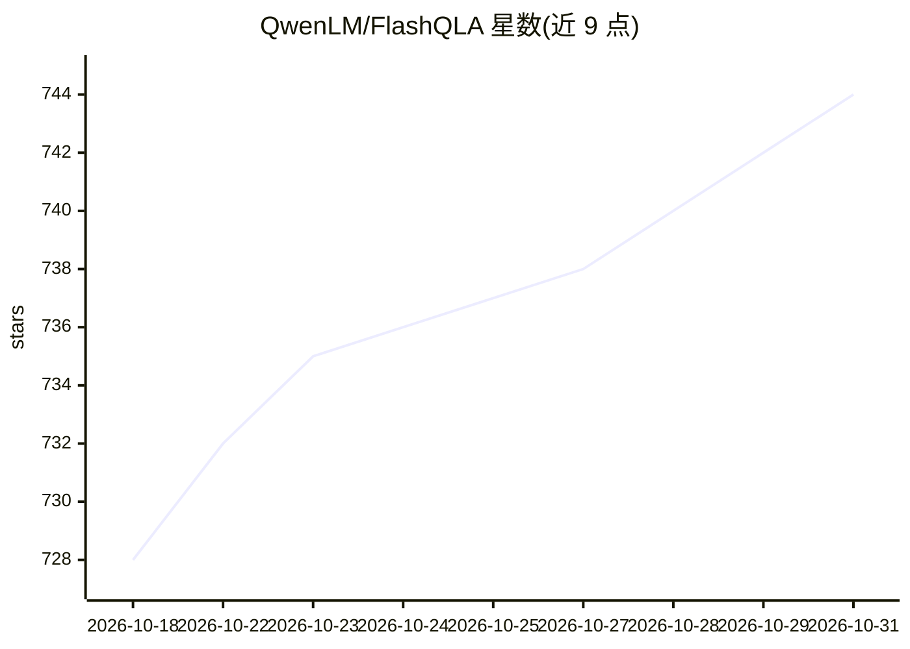

# QwenLM/FlashQLA

⭐ 744 · Python · MIT · 推送 2026-10-30 · [GitHub](https://github.com/QwenLM/FlashQLA) · 组织维护 · 中文 README

**基于 TileLang 的 GDN 线性注意力高性能 GPU 核文库**

面向 Gated DeltaNet（GDN）Chunked Prefill 前向与反向传播的 GPU 核心库，用 TileLang 构建多个融合 warp-specialized 内核，通过算子融合与代数重构降低 Tensor Core/CUDA Core/SFU 开销；利用 GDN 门的指数衰减特性在 TP、长序列、小头数场景自动启用卡内上下文并行，v0.1.3 加入两级（卡间/卡内）上下文并行。要求 SM90/SM100/SM103/SM120/SM121 架构与 CUDA 12.8+、PyTorch 2.8+，支持作为 flash-linear-attention GDN 的后端经标准 FLA API 调用。供训练与推理框架开发者集成使用。

## 筛选速览

| 维度 | 判定 | 备注 |
|---|---|---|
| AI 角色 | `ai-ecosystem` | LLM/agent 周边工具 |
| 许可风险 | `permissive` | MIT |
| 部署形态 | `library` | 以包/库形式分发 |
| 模型依赖 | — | README 未给出锁定关系 |
| 硬件要求 | — | 无带数字的原话,不猜 |
| 安装摩擦 | `medium` | 含编译或系统依赖之一 |
| 成熟度 | — | 结构信号不足 |

## 能力要点

- TileLang 融合 warp-specialized 内核，覆盖 GDN Chunked Prefill 前向与反向
- 门驱动的卡内上下文并行自动启用（TP/长序列/小头数场景）
- v0.1.3 支持卡间+卡内两级上下文并行
- 可作为 flash-linear-attention GDN 后端，经标准 FLA API 即插即用

## 适用场景

- 加速线性注意力模型的预训练前反向计算
- 为 flash-linear-attention 生态提供 GDN 加速后端
- 长序列与边缘侧 agentic 推理场景的核函数优化

## 场景标签

`模型训练` `推理引擎` · 领域:训练与推理

## 证据(README 行号)

> L11: FlashQLA is a high-performance linear attention kernel library built on TileLang. FlashQLA applies **reasonable ope
> L6: - [2026-07] 🚀 Release FlashQLA v0.1.2 — adds forward pass for SM120 (Blackwell, thanks @minatoyukinaa) and now serve

## 星数曲线

2026-10-18 728 → 2026-10-31 744（+16）

---
*卡片 v1 · prompt 1.4 · 生成 2026-10-21 · 置信度 high · 依据 README sha `2530f4df77ef` · [字段定义](../../DATASET.md)*
