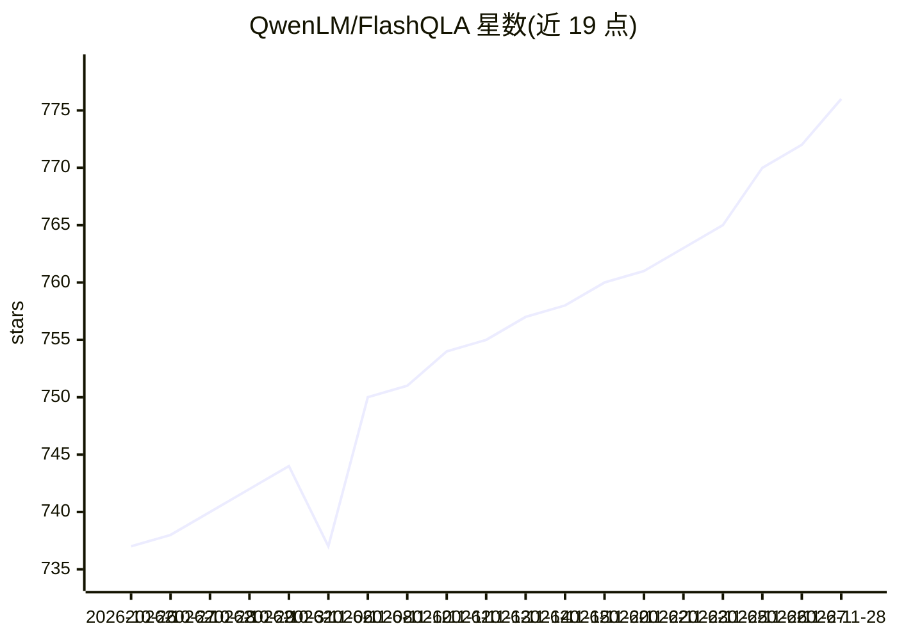

# QwenLM/FlashQLA

⭐ 776 · Python · MIT · 推送 2026-11-25 · [GitHub](https://github.com/QwenLM/FlashQLA) · 组织维护 · 中文 README

**基于 TileLang 的线性注意力 GDN 计算内核库**

QwenLM 团队开源的线性注意力内核库，用 TileLang 实现融合内核，对 GDN Chunked Prefill 的前向与反向计算做算子融合与性能优化，支持单卡上下文并行与多卡两级 Dual CP 序列并行（最长 1M token）。提供高层与低层两级 Python API，可与 flash-linear-attention 的 GDN 后端对接，通过 pip 或源码安装。硬件限定 SM90/SM100/SM103/SM120/SM121 GPU、CUDA 12.8+、PyTorch 2.8+。

## 筛选速览

| 维度 | 判定 | 备注 |
|---|---|---|
| AI 角色 | `ai-native` | 本体是模型或模型工具 |
| 许可风险 | `permissive` | MIT |
| 部署形态 | `library` | 以包/库形式分发 |
| 模型依赖 | — | README 未给出锁定关系 |
| 硬件要求 | — | 无带数字的原话,不猜 |
| 安装摩擦 | `medium` | 含编译或系统依赖之一 |
| 成熟度 | — | 结构信号不足 |

## 能力要点

- TileLang 融合 warp-specialized 内核，覆盖 GDN 前向与反向计算
- 单卡门控自动上下文并行与多卡 Dual CP 两级序列并行
- 兼容 flash-linear-attention 的标准 API，可即插即用加速 GDN
- 提供高层/低层两级 API 与 pytest 测试、profiling 脚本

## 适用场景

- 为使用 GDN 线性注意力的模型训练加速前向与反向计算
- 长上下文（最长 1M token）多 GPU 预训练场景
- 边缘端 agent 推理中的线性注意力计算加速

## 场景标签

`模型训练` · 领域:训练与推理

## 证据(README 行号)

> L12: FlashQLA is a high-performance linear attention kernel library built on TileLang. FlashQLA applies **reasonable ope
> L22: 4. **TileLang fused warp-specialized kernels**. Rather than following the step-by-step decomposition into independe

## 星数曲线

2026-10-26 737 → 2026-11-28 776（+39）

---
*卡片 v1 · prompt 1.4 · 生成 2026-11-26 · 置信度 high · 依据 README sha `5840a98ec276` · [字段定义](../../DATASET.md)*
