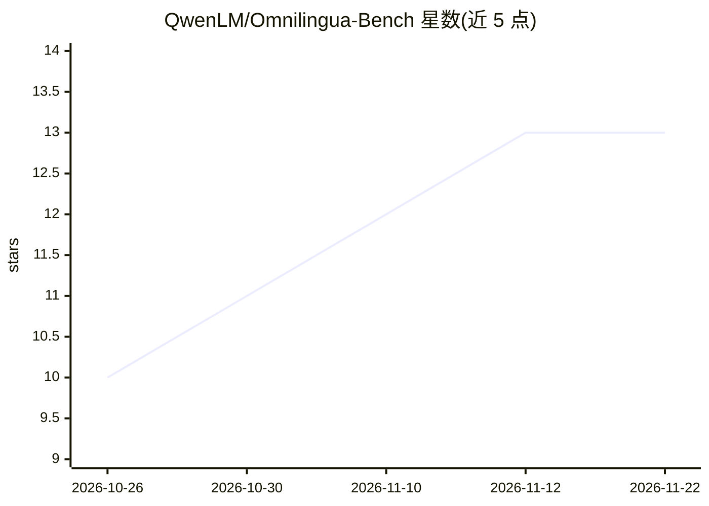

# QwenLM/Omnilingua-Bench

⭐ 13 · Python · 推送 2026-10-28 · [GitHub](https://github.com/QwenLM/Omnilingua-Bench) · 组织维护 · 中文 README

**面向多语言全模态模型的长音频评测基准数据集**

QwenLM 发布的评测基准仓库，包含 6 个子集：长音频转写（LongASR）、长音频问答（MuLA-Bench，5,038 条问答、16 种语言、1,341 小时）、多说话人转写与归属（MSpeaker，含音视频轨道）、语音复杂指令遵循（MaXIFE，47 种约束）、多轮语音对话评测（AudioMC，rubric LLM 裁判评分）。仓库以 JSONL 索引与标注形式发布，不含真实媒体文件，MSpeaker 等需使用者自行通过 source_url 下载；提供 validate.py 脚本校验数据结构与媒体存在性，要求 Python 3.10+。

## 筛选速览

| 维度 | 判定 | 备注 |
|---|---|---|
| AI 角色 | `ai-knowledge` | 知识聚合/清单类 |
| 许可风险 | `none` | — |
| 部署形态 | `library` | 以包/库形式分发 |
| 模型依赖 | — | README 未给出锁定关系 |
| 硬件要求 | — | 无带数字的原话,不猜 |
| 安装摩擦 | `low` | 无编译、无系统依赖或容器化 |
| 成熟度 | — | 结构信号不足 |

## 能力要点

- 6 个子集覆盖转写、长音频问答、多说话人、指令遵循与多轮对话
- LongASR 单条音频约 30.56–200.04 分钟，LongQA 覆盖 16 种语言 8 个领域
- 提供 tools/validate.py 校验清单结构与媒体文件存在性
- AudioMC 采用 rubric LLM-judge 评分，含 en_tts 控制组

## 适用场景

- 评测语音模型在 30 分钟以上长音频上的转写完整性
- 考察多语言语音指令遵循与约束满足情况
- 评估多说话人场景下的说话人归属与时间对齐能力
- 测试多轮语音对话中的记忆、指令保持与语音编辑能力

## 场景标签

`模型评测` · 领域:评测与运维

## 证据(README 行号)

> L5: **Multilingual, omni-modal evaluation of long-audio recognition, multi-speaker understanding, and instruction follow
> L7: ## Subsets
> L34: The released datasets use relative-path placeholders in `input.media[].path`; the repository **does not include the

## 星数曲线

2026-10-26 10 → 2026-11-22 13（+3）

---
*卡片 v1 · prompt 1.4 · 生成 2026-11-18 · 置信度 high · 依据 README sha `1d4f13f07839` · [字段定义](../../DATASET.md)*
