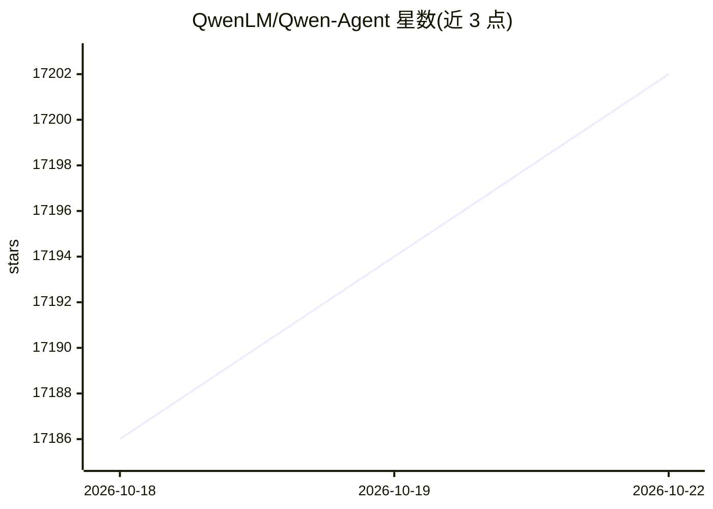

# QwenLM/Qwen-Agent

⭐ 17,205 · Python · Apache-2.0 · 推送 2026-03-04 · [GitHub](https://github.com/QwenLM/Qwen-Agent) · [官网](https://pypi.org/project/qwen-agent/) · 组织维护 · 中文 README

**面向开发者的 Qwen 系列 LLM 应用开发 Agent 框架**

基于 Qwen 模型的指令遵循、工具使用、规划与记忆能力构建 LLM 应用的 Python 框架，提供 BaseChatModel、BaseTool、Agent 等原子与高层组件，内置 Function Calling、MCP 接入、基于本地 Docker 容器的 Code Interpreter 与快速 RAG 方案，附带 Gradio WebUI 部署及 BrowserQwen 浏览器助手等示例应用。模型服务可使用阿里云 DashScope API 或自行部署 OpenAI 兼容服务（vLLM/Ollama）。代码解释器沙箱隔离为基本实现，官方提示在生产环境谨慎使用；GUI 需 Python 3.10+。

## 筛选速览

| 维度 | 判定 | 备注 |
|---|---|---|
| AI 角色 | `ai-native` | 本体是模型或模型工具 |
| 许可风险 | `permissive` | Apache-2.0 |
| 部署形态 | `library` | 以包/库形式分发 |
| 模型依赖 | local-ok | 支持本地模型 |
| 硬件要求 | — | 无带数字的原话,不猜 |
| 安装摩擦 | `low` | 无编译、无系统依赖或容器化 |
| 成熟度 | — | 结构信号不足 |

## 动量与使用信号

- 维护:`declining` — 距上次 push 228.0 天,年发版 0,30 位贡献者
- 涨星:近 1 天 **+1**(自 20261016 起算)
- 安装:pypi 包 `qwen-agent` 月下载 112,735
- 平台:— · 协议:OPENAI-API / MCP / OLLAMA

## 能力要点

- 提供 Function Calling、MCP、Code Interpreter、RAG 等内置能力
- 基于本地 Docker 容器的代码解释器沙箱执行
- 支持 1M token 超长文档问答的快速 RAG 方案
- Gradio WebUI 一行代码部署 Agent 界面

## 适用场景

- 为 Qwen 系列模型开发带工具调用的自定义助手
- 对超长文档进行检索增强问答
- 通过浏览器扩展让模型辅助网页浏览操作
- 接入 MCP 服务器扩展 agent 可用工具

## 场景标签

`Agent 框架` `RAG` `文档问答` · 领域:Agent 开发

## 证据(README 行号)

> L7: Qwen-Agent is a framework for developing LLM applications based on the instruction following, tool usage, planning, 
> L59: Qwen-Agent offers atomic components, such as LLMs (which inherit from `class BaseChatModel` and come with function 
> L86: We implement a code interpreter tool based on local Docker containers. You can enable the built-in `code interprete

## 星数曲线

2026-10-18 17,186 → 2026-10-22 17,202（+16）

---
*卡片 v1 · prompt 1.4 · 生成 2026-10-18 · 置信度 high · 依据 README sha `f39d13241583` · [字段定义](../../DATASET.md)*
