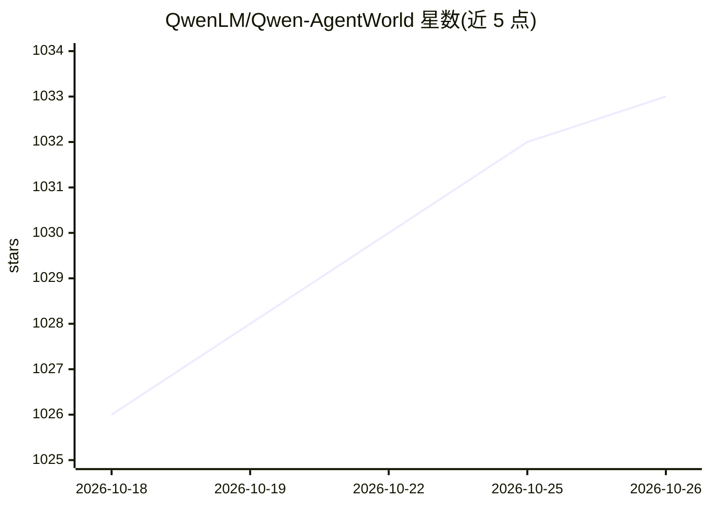

# QwenLM/Qwen-AgentWorld

⭐ 1,033 · Python · Apache-2.0 · 推送 2026-07-20 · [GitHub](https://github.com/QwenLM/Qwen-AgentWorld) · [官网](https://arxiv.org/abs/2606.24597) · 组织维护 · 中文 README

**面向通用 Agent 的语言世界模型（模拟环境）与配套评测基准**

Qwen 团队开源的语言世界模型权重（Qwen-AgentWorld-35B-A3B，MoE，35B 总参数/3B 激活，256K 上下文）及 AgentWorldBench 评测基准。模型通过长链推理在 MCP、Search、Terminal、SWE、Android、Web、OS 七个统一领域模拟 agent 交互环境，经 CPT/SFT/RL 三阶段在超 1000 万条真实交互轨迹上训练，可作为环境模拟器或 agent 基础模型使用。权重发布于 HuggingFace 与 ModelScope，支持 SGLang/vLLM/Transformers 推理，附七领域系统提示模板与评测脚本，Apache 2.0 许可。

## 筛选速览

| 维度 | 判定 | 备注 |
|---|---|---|
| AI 角色 | `ai-native` | 本体是模型或模型工具 |
| 许可风险 | `permissive` | Apache-2.0 |
| 部署形态 | `library` | 以包/库形式分发 |
| 模型依赖 | local-ok | 支持本地模型 |
| 硬件要求 | — | 无带数字的原话,不猜 |
| 安装摩擦 | `low` | 无编译、无系统依赖或容器化 |
| 成熟度 | — | 结构信号不足 |

## 能力要点

- 单一模型覆盖七个 agent 交互领域的环境模拟
- MoE 架构：35B 总参数/3B 激活，256K 上下文
- 提供 AgentWorldBench（七领域、五维度打分）与独立评测脚本
- 提供各领域世界模型系统提示模板（prompts/ 目录）

## 适用场景

- 为 agent RL 训练提供可控/可扰动/虚构世界模拟环境
- 作为 agent 基础模型经 RL warm-up 迁移到工具调用任务
- 用 AgentWorldBench 评测语言世界模型的环境模拟能力

## 场景标签

`模型评测` `强化学习` · 领域:评测与运维

## 证据(README 行号)

> L34: **Qwen-AgentWorld** is a native language world model that simulates agentic environments via long chain-of-thought 
> L19: We open-source Qwen-AgentWorld-35B-A3B (model weights) and AgentWorldBench (evaluation benchmark):
> L23: |Qwen-AgentWorld-35B-A3B|Language world model (MoE, 35B total / 3B active, 256K context)|

## 星数曲线

2026-10-18 1,026 → 2026-10-26 1,033（+7）

---
*卡片 v1 · prompt 1.4 · 生成 2026-10-21 · 置信度 mid · 依据 README sha `e9f0700a909b` · [字段定义](../../DATASET.md)*
