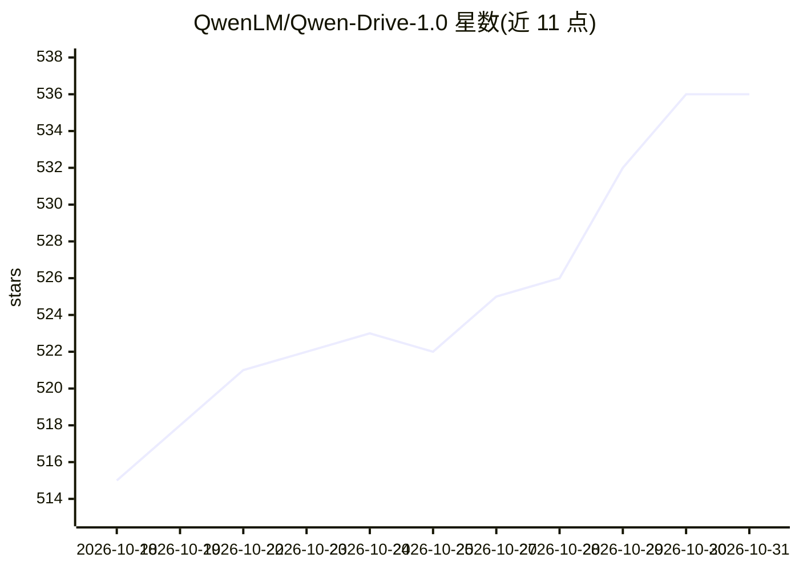

# QwenLM/Qwen-Drive-1.0

⭐ 536 · Python · Apache-2.0 · 推送 2026-09-03 · [GitHub](https://github.com/QwenLM/Qwen-Drive-1.0) · 组织维护 · 中文 README

**面向自动驾驶的视觉-语言基础模型：3D 感知、驾驶问答与轨迹规划**

Qwen 团队与华中科技大学发布的自动驾驶视觉-语言基础模型（4B VLM 底座），在 Qwen3.5 架构上外接两个模块：BEV 感知头（3D 检测、语义占据预测、BEV 地图分割）与规划专家（生成自车未来轨迹），LLM 解码器保持不变，可同时处理通用与驾驶 VQA。模型权重从 Hugging Face/ModelScope 下载，单目录发布共约 9.1 GB（含任务头）。源码安装需 git clone，推荐 24 GB+ 显存的 GPU，demo 数据随仓库自带。采用分阶段训练（SFT 与 RL 规划专家），Apache 2.0 许可。

## 筛选速览

| 维度 | 判定 | 备注 |
|---|---|---|
| AI 角色 | `ai-native` | 本体是模型或模型工具 |
| 许可风险 | `permissive` | Apache-2.0 |
| 部署形态 | `None` |  |
| 模型依赖 | — | README 未给出锁定关系 |
| 硬件要求 | — | 无带数字的原话,不猜 |
| 安装摩擦 | `medium` | 含编译或系统依赖之一 |
| 成熟度 | — | 结构信号不足 |

## 能力要点

- 统一框架内集成 3D 感知、VQA 与运动规划
- BEV 感知头支持 3D 检测/占据预测/地图分割
- 规划专家分 SFT 与 RL 两个版本，可加载切换
- 仓库自带 4 个 demo 场景，仅需权重即可运行

## 适用场景

- 在 NAVSIM/Waymo 等基准上做端到端轨迹规划评测
- 对驾驶场景做视觉问答与因果推理
- 进行 BEV 3D 感知推理与可视化
- 作为自动驾驶 VLM 研究的基线模型

## 场景标签

`多模态` · 领域:感知与多模态

## 证据(README 行号)

> L19: Qwen-Drive-1.0 retains the architecture of the pretrained Qwen3.5 vision-language model and
> L20: integrates **3D perception**, **visual question answering**, and **motion planning** within a
> L21: unified framework. The natively multimodal Qwen3.5-4B serves as the shared VLM, with two

## 星数曲线

2026-10-18 515 → 2026-10-31 536（+21）

---
*卡片 v1 · prompt 1.4 · 生成 2026-10-21 · 置信度 high · 依据 README sha `d598ae637f55` · [字段定义](../../DATASET.md)*
