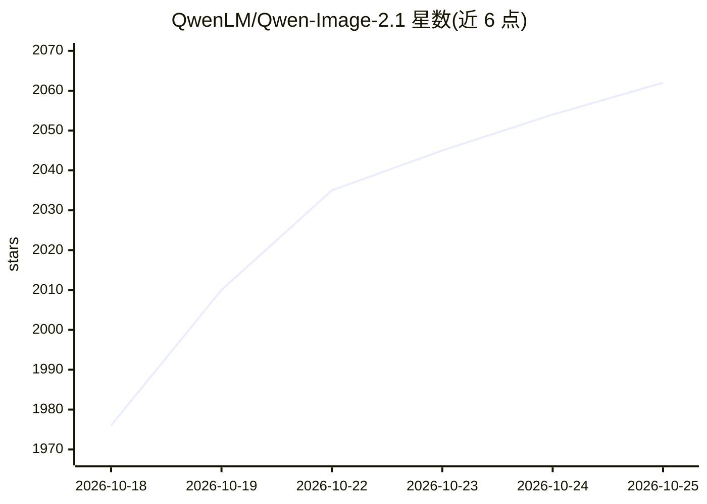

# QwenLM/Qwen-Image-2.1

⭐ 2,062 · Python · NOASSERTION · 推送 2026-10-14 · [GitHub](https://github.com/QwenLM/Qwen-Image-2.1) · 组织维护 · 中文 README

**7B 文生图与图像编辑统一模型，支持透明图生成与多参考编辑**

Qwen 团队开源的文生图与图像编辑统一模型：视觉生成组件 7B 参数、32 层单流 DiT 架构，文本编码器为 Qwen3-VL 8B，VAE 为 64 通道 RGBA 自编码器。支持原生透明（RGBA）图像生成、最多 10 张参考图像的多主体编辑、圆圈/涂鸦/蒙版局部编辑、人物与商品身份保持，原生 2K 分辨率。提供 Turbo 版（8 步去噪）、提示词改写子模型及 Diffusers/vLLM-Omni/SGLang/LightX2V/ComfyUI 多种运行方式，另有官方托管 API。

## 筛选速览

| 维度 | 判定 | 备注 |
|---|---|---|
| AI 角色 | `ai-native` | 本体是模型或模型工具 |
| 许可风险 | `none` | NOASSERTION |
| 部署形态 | `library` | 以包/库形式分发 |
| 模型依赖 | local-ok | 支持本地模型 |
| 硬件要求 | — | 无带数字的原话,不猜 |
| 安装摩擦 | `medium` | 含编译或系统依赖之一 |
| 成熟度 | — | 结构信号不足 |

## 能力要点

- 文生图与图像编辑统一在单一模型，支持最多 10 张参考图
- 原生 RGBA 透明图像生成与主体提取
- Turbo 版 8 步去噪完成生成与编辑
- 配套提示词改写模型（T2I/Edit 两个 Qwen3.5-VL 9B 检查点）

## 适用场景

- 用 Diffusers 或 ComfyUI 本地生成 2K 图像
- 基于多张参考图做人物合影、商品换装等编辑
- 生成带透明通道的设计素材
- 通过 vLLM/SGLang 部署图像生成服务

## 场景标签

`图像生成` · 领域:内容生成

## 证据(README 行号)

> L10: We are excited to open-source **Qwen-Image-2.1**, a unified text-to-image generation and image editing model in the
> L15: - **Native Transparency, Unified Creation and Editing** — Generate regular or transparent (RGBA) images from text, 

## 星数曲线

2026-10-18 1,976 → 2026-10-25 2,062（+86）

---
*卡片 v1 · prompt 1.4 · 生成 2026-10-21 · 置信度 high · 依据 README sha `2a7da48b6f8e` · [字段定义](../../DATASET.md)*
