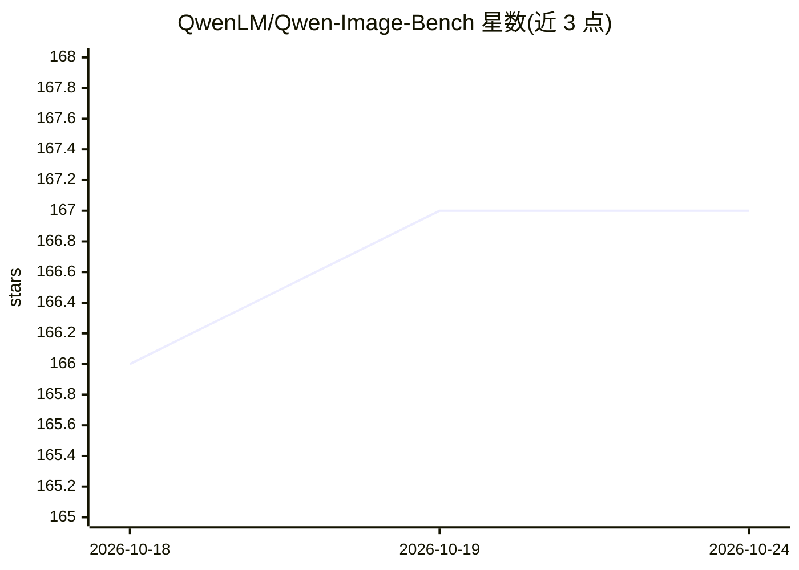

# QwenLM/Qwen-Image-Bench

⭐ 167 · Python · Apache-2.0 · 推送 2026-06-18 · [GitHub](https://github.com/QwenLM/Qwen-Image-Bench) · 组织维护 · 中文 README

**文生图模型评测工具包：用 Q-Judger 给生成图像打分**

面向文本生成图像（T2I）模型的评测工具包：使用微调的 Q-Judger（Qwen3.6-27B）对生成图像在 5 个层级维度（质量、美学、对齐、真实世界保真、创意生成）共 56 个细粒度面上打分，采用三级聚合评分体系（L3→L2→L1→Overall）。提供 judge.py 对用户自生成图像运行推理，以及 compute_scores.py 从预生成回答复现榜单；推理基于 ms-swift，固定推理参数保证可复现。安装需 clone 仓库并自建环境装 PyTorch 与依赖。

## 筛选速览

| 维度 | 判定 | 备注 |
|---|---|---|
| AI 角色 | `ai-ecosystem` | LLM/agent 周边工具 |
| 许可风险 | `permissive` | Apache-2.0 |
| 部署形态 | `library` | 以包/库形式分发 |
| 模型依赖 | — | README 未给出锁定关系 |
| 硬件要求 | — | 无带数字的原话,不猜 |
| 安装摩擦 | `medium` | 含编译或系统依赖之一 |
| 成熟度 | — | 结构信号不足 |

## 能力要点

- 5 个 L1 维度、23 个 L2 子能力、56 个 L3 细粒度面的层级评分体系
- 支持对任意 T2I 模型的生成图像运行 judge 推理并获得结构化多维分数
- 可从已发布的基准数据集复现榜单分数
- 推理基于 ms-swift，固定 seed/temperature 等参数保证可复现

## 适用场景

- 给我自己的文生图模型输出做多维度打分对比
- 复现 Qwen-Image-Bench 排行榜的分数
- 把评测结果导出为 JSON/Excel 报告

## 场景标签

`模型评测` · 领域:评测与运维

## 证据(README 行号)

> L9: An evaluation toolkit for text-to-image (T2I) generation models. It uses a fine-tuned **Q-Judger** (Qwen3.6-27B) to 
> L15: - **Evaluate any T2I model** — run the judge model on your own generated images and get structured, multi-dimension
> L61: ### Evaluate Your Own T2I Model (`judge.py`)

## 星数曲线

2026-10-18 166 → 2026-10-24 167（+1）

---
*卡片 v1 · prompt 1.4 · 生成 2026-10-22 · 置信度 mid · 依据 README sha `3a403639f8f0` · [字段定义](../../DATASET.md)*
