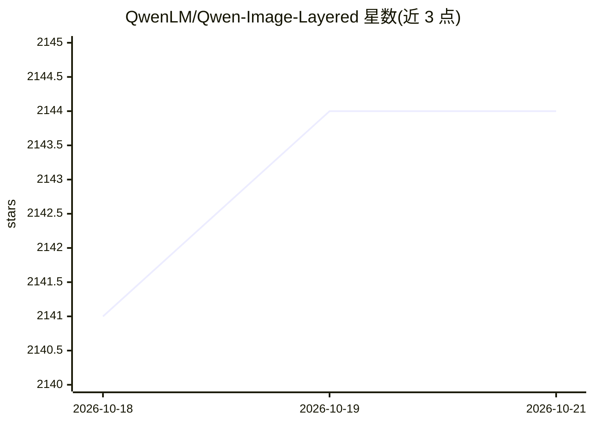

# QwenLM/Qwen-Image-Layered

⭐ 2,144 · Python · Apache-2.0 · 推送 2025-12-31 · [GitHub](https://github.com/QwenLM/Qwen-Image-Layered) · 组织维护 · 中文 README

**将图像分解为多个 RGBA 图层的生成模型，实现图层级编辑**

Qwen 团队发布的图像图层分解模型：输入一张图像，输出多个可独立操作的 RGBA 图层，将语义或结构组件物理隔离到不同图层，支持缩放、移动、重新着色、删除对象等操作且不影响其他内容；支持可变层数分解与递归分解。基于 transformers（>=4.51.3）与 diffusers 的 QwenImageLayeredPipeline 运行，提供 Gradio 网页界面（app.py）分解图像并导出 pptx/zip/psd 图层；图层编辑依赖 Qwen-Image-Edit。已发布权重（HuggingFace/ModelScope），Apache 2.0 许可。限制：提示词描述整图而非单层语义；文生多层 RGBA 能力有限。

## 筛选速览

| 维度 | 判定 | 备注 |
|---|---|---|
| AI 角色 | `ai-native` | 本体是模型或模型工具 |
| 许可风险 | `permissive` | Apache-2.0 |
| 部署形态 | `library` | 以包/库形式分发 |
| 模型依赖 | local-ok | 支持本地模型 |
| 硬件要求 | — | 无带数字的原话,不猜 |
| 安装摩擦 | `low` | 无编译、无系统依赖或容器化 |
| 成熟度 | — | 结构信号不足 |

## 能力要点

- 图像分解为多个 RGBA 图层，各层可独立编辑且互不影响
- 支持可变层数（如 3 或 8 层）与递归分解
- Gradio 界面可导出 pptx、zip、psd 图层文件
- vLLM-Omni 已支持该模型

## 适用场景

- 把照片拆成图层后在 Photoshop/PPT 中独立编辑
- 删除、缩放、移动图中对象而不破坏其余内容
- 替换指定图层内容（配合 Qwen-Image-Edit）

## 场景标签

`图像生成` · 领域:内容生成

## 证据(README 行号)

> L4: We are excited to introduce **Qwen-Image-Layered**, a model capable of decomposing an image into multiple RGBA layer
> L30: from diffusers import QwenImageLayeredPipeline

## 星数曲线

2026-10-18 2,141 → 2026-10-21 2,144（+3）

---
*卡片 v1 · prompt 1.4 · 生成 2026-10-21 · 置信度 mid · 依据 README sha `b5102e8ddb24` · [字段定义](../../DATASET.md)*
