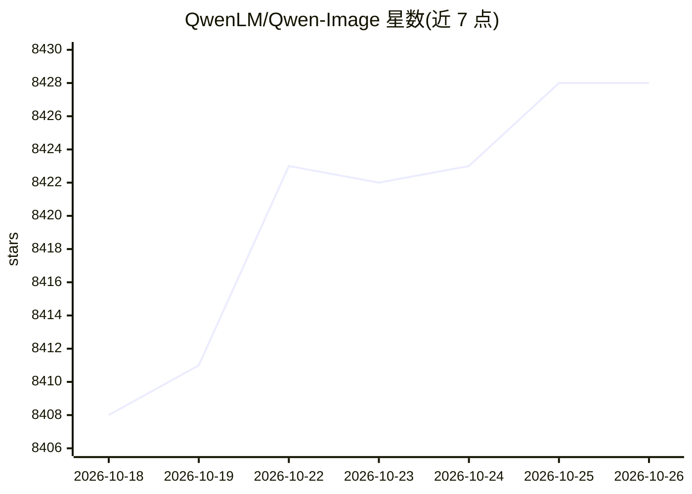

# QwenLM/Qwen-Image

⭐ 8,428 · Python · Apache-2.0 · 推送 2026-02-10 · [GitHub](https://github.com/QwenLM/Qwen-Image) · 组织维护 · 中文 README

**20B 文生图/图像编辑基础模型，擅长中英复杂文字渲染**

阿里通义千问团队开源的 20B 参数 MMDiT 图像生成基础模型，覆盖文生图与指令式图像编辑两类任务，迭代版本包括 Qwen-Image-2512、Qwen-Image-Edit-2511 与 Qwen-Image-2.0。核心机制为基于 diffusers 的 Pipeline 调用，可选 Qwen-Plus/Qwen-VL-Max 驱动的提示词增强（需 DASHSCOPE_API_KEY），并提供多 GPU Gradio API Server 部署脚本。限制：编辑任务建议使用提示词改写以保持稳定性，需 transformers>=4.51.3 与最新 diffusers。

## 筛选速览

| 维度 | 判定 | 备注 |
|---|---|---|
| AI 角色 | `ai-native` | 本体是模型或模型工具 |
| 许可风险 | `permissive` | Apache-2.0 |
| 部署形态 | `library` | 以包/库形式分发 |
| 模型依赖 | — | README 未给出锁定关系 |
| 硬件要求 | — | 无带数字的原话,不猜 |
| 安装摩擦 | `low` | 无编译、无系统依赖或容器化 |
| 成熟度 | — | 结构信号不足 |

## 能力要点

- 文生图与图像编辑统一在 MMDiT 架构下（20B 参数）
- 中文/复杂文字渲染为官方标注的重点能力
- 支持 LoRA（如 MajicBeauty）与 ComfyUI 原生接入
- 提供多 GPU 并行的 Gradio API Server 部署方案

## 适用场景

- 本地部署文生图服务，生成含大量文字的海报/信息图
- 基于指令对图像进行局部编辑与一致性保持
- 通过 ComfyUI 或 diffusers 集成到现有生成工作流

## 场景标签

`图像生成` · 领域:内容生成

## 证据(README 行号)

> L8: We are thrilled to release **Qwen-Image**, a 20B MMDiT image foundation model that achieves significant advances in 
> L73: from diffusers import QwenImagePipeline
> L92: The following contains a code snippet illustrating how to use the model to generate images based on text prompts:

## 星数曲线

2026-10-18 8,408 → 2026-10-26 8,428（+20）

---
*卡片 v1 · prompt 1.4 · 生成 2026-10-20 · 置信度 high · 依据 README sha `149d7ec8408d` · [字段定义](../../DATASET.md)*
