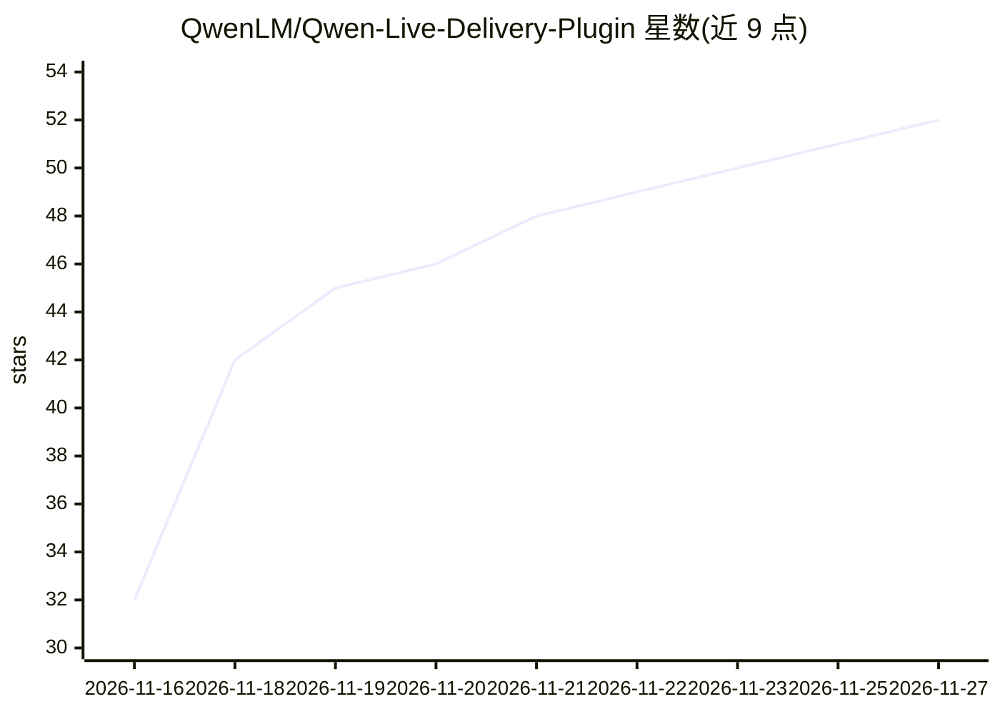

# QwenLM/Qwen-Live-Delivery-Plugin

⭐ 52 · TypeScript · Apache-2.0 · 推送 2026-11-23 · [GitHub](https://github.com/QwenLM/Qwen-Live-Delivery-Plugin) · 组织维护 · 中文 README

**Codex CLI 长任务持续交付与人机协同插件**

由 Qwen 团队维护的轻量级插件，面向 Codex CLI 的长时任务场景：引导 Agent 先交付最小可用版本、逐版本迭代并保留完整版本快照。由三部分组成——$ld:go 技能引导迭代规划、MCP 工具（ld_begin/ld_publish/ld_status/ld_done）管理交付状态与预算、生命周期 Hook 在会话恢复与工具调用后注入用户反馈。附本地浏览器工作台，支持预览下载版本、追加需求、调整预算或停止任务。安装不包含模型与 API key，使用 Codex 自身的模型与认证；仅支持 Linux/macOS、Node.js 22+，版本 0.1.0，测试于 Codex 0.166.0/0.167.1。

## 筛选速览

| 维度 | 判定 | 备注 |
|---|---|---|
| AI 角色 | `ai-ecosystem` | LLM/agent 周边工具 |
| 许可风险 | `permissive` | Apache-2.0 |
| 部署形态 | `library` | 以包/库形式分发 |
| 模型依赖 | — | README 未给出锁定关系 |
| 硬件要求 | — | 无带数字的原话,不猜 |
| 安装摩擦 | `low` | 无编译、无系统依赖或容器化 |
| 成熟度 | — | 结构信号不足 |

## 能力要点

- 三模块：Live Delivery Skill + MCP 交付工具 + 生命周期 Hooks
- 本地浏览器工作台：预览/下载版本、追加需求、调预算、停止任务
- 版本快照保留与时间预算控制（最长 7 天）
- 安装复用 Codex 的模型与认证，不内置模型/API key

## 适用场景

- 让 Codex 长时间开发项目的同时逐版本验收成果
- 任务中途随时补充需求并让 Agent 纳入后续版本
- 在浏览器工作台预览、下载与回溯历史交付版本

## 场景标签

`编码 Agent` · 领域:编码与开发

## 证据(README 行号)

> L5: **Available at launch: Codex CLI** · **Supported platforms: Linux · macOS** · Node.js 22+
> L11: As long-horizon AI agents become increasingly mainstream, a very real concern remains: have you ever felt uneasy ha

## 星数曲线

2026-11-16 32 → 2026-11-27 52（+20）

---
*卡片 v1 · prompt 1.4 · 生成 2026-11-18 · 置信度 mid · 依据 README sha `fad95f1a8f68` · [字段定义](../../DATASET.md)*
