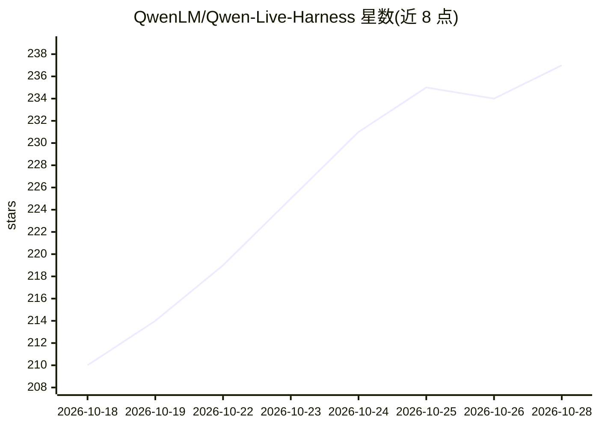

# QwenLM/Qwen-Live-Harness

⭐ 238 · TypeScript · Apache-2.0 · 推送 2026-10-21 · [GitHub](https://github.com/QwenLM/Qwen-Live-Harness) · 组织维护 · 中文 README

**基于 Qwen Omni Realtime API 的桌面实时语音视频 Agent**

围绕 Qwen Omni Realtime API 构建的开源 agent harness：提供实时音视频交互（屏幕/摄像头上下文）、把复杂任务委托给 Qwen Code、Codex、Claude Code、Gemini CLI 等后台 harness、按音频/视觉/时间条件触发主动提醒，以及跨会话长期记忆（本地存储、云端推理）。架构为 Electron 桌面 Host 加 Node.js daemon 两进程，经本地 WebSocket 通信。通过 npm 全局安装，需 DashScope API key；目前完整桌面体验仅支持 macOS 12+，无需本地模型权重或 GPU，Windows/Linux 支持开发中。

## 筛选速览

| 维度 | 判定 | 备注 |
|---|---|---|
| AI 角色 | `ai-native` | 本体是模型或模型工具 |
| 许可风险 | `permissive` | Apache-2.0 |
| 部署形态 | `desktop` | 安装包/桌面程序 |
| 模型依赖 | — | README 未给出锁定关系 |
| 硬件要求 | — | 无带数字的原话,不猜 |
| 安装摩擦 | `low` | 无编译、无系统依赖或容器化 |
| 成熟度 | `idea` | |

## 能力要点

- 实时音视频交互，支持屏幕/摄像头上下文与多种采集模式
- 任务委托给 Qwen Code/Qoder CLI/Codex/Claude Code/Gemini CLI 后台 harness（ACP 协议）
- 音频/视觉/时间条件触发的主动提醒与监控解说
- 多记忆库长期记忆，本地存储、可创建/选择/重命名

## 适用场景

- 对着屏幕语音对话，让我边看边讲解或排查代码报错
- 把研究、写文档等任务交给后台 coding agent 并语音跟进结果
- 设置条件让它在特定事件发生时主动提醒我

## 场景标签

`语音 Agent` `AI 助手` · 领域:对话与助手

## 证据(README 行号)

> L14: **Qwen-Live-Harness** is an open-source harness built around the **Qwen Omni Realtime API**. Install it with one co
> L22: - **Realtime interaction**: Interact through audio and video with screen or camera context. Switch input devices, v
> L23: - **Task delegation**: Hand work to background harnesses such as Qwen Code, Qoder CLI, Codex, Claude Code, and Gemi

## 星数曲线

2026-10-18 210 → 2026-10-28 237（+27）

---
*卡片 v1 · prompt 1.4 · 生成 2026-10-22 · 置信度 high · 依据 README sha `0b8040f2f792` · [字段定义](../../DATASET.md)*
