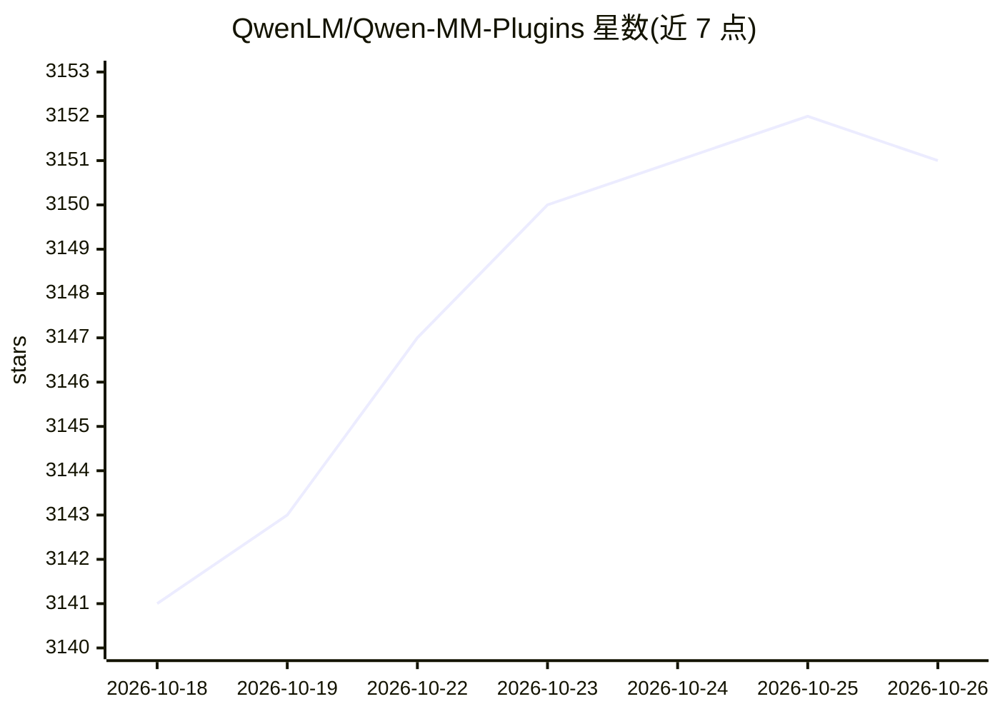

# QwenLM/Qwen-MM-Plugins

⭐ 3,151 · Python · Apache-2.0 · 推送 2026-10-23 · [GitHub](https://github.com/QwenLM/Qwen-MM-Plugins) · 组织维护 · 中文 README

**让任意 agent 框架获得原生多模态能力的 Qwen 官方插件集**

Qwen 团队维护的多模态插件集合：每个能力以 Skill 加可选 MCP server 形式独立安装，为 Claude Code、Codex、Qwen Code、Gemini CLI 等十余种 agent 框架注入图像/视频/文档/3D 读取、长视频记忆、视频生成编辑、Blender/FreeCAD 驱动、硬件操控等能力。core 插件默认本地原生模式无需 API key；api/search/video-memory 等插件需 DashScope 或搜索服务凭据，部分能力依赖 ffmpeg、Node、Blender 等本机程序。提供 curl 一键安装脚本与配置校验动作。

## 筛选速览

| 维度 | 判定 | 备注 |
|---|---|---|
| AI 角色 | `ai-ecosystem` | LLM/agent 周边工具 |
| 许可风险 | `permissive` | Apache-2.0 |
| 部署形态 | `None` |  |
| 模型依赖 | — | README 未给出锁定关系 |
| 硬件要求 | — | 无带数字的原话,不猜 |
| 安装摩擦 | `medium` | 含编译或系统依赖之一 |
| 成熟度 | — | 结构信号不足 |

## 能力要点

- 每个能力独立安装为 Skill + 可选 MCP server
- core 插件原生读取图像/视频/文档/3D，默认模式无需 API key
- 覆盖十余种 agent 框架（Claude Code、Codex、Gemini CLI 等）的引导式安装
- 能力涉及长视频记忆、视频生成编辑、Blender/FreeCAD、物理硬件操控（MHS）

## 适用场景

- 让编程 agent 直接读取和总结 PDF、会议录像等多模态文件
- 为长视频建立层级记忆后做带时间戳的问答
- 通过 agent 驱动 Blender/FreeCAD 做 3D 建模与参数化 CAD
- 把演示视频转成可复用的 Agent Skill

## 场景标签

`多模态` `视频生成` · 领域:内容生成

## 证据(README 行号)

> L5: Native multimodal plugins for Qwen models. Make any agent harness multimodal-native.
> L64: Each capability is installed independently as a **Skill** plus an optional **MCP server**, named
> L65: `qwen-mm-plugins-<capability>`. Pick by your agent's main model. We strongly recommend the `core`

## 星数曲线

2026-10-18 3,141 → 2026-10-26 3,151（+10）

---
*卡片 v1 · prompt 1.4 · 生成 2026-10-20 · 置信度 high · 依据 README sha `594e249a2a54` · [字段定义](../../DATASET.md)*
