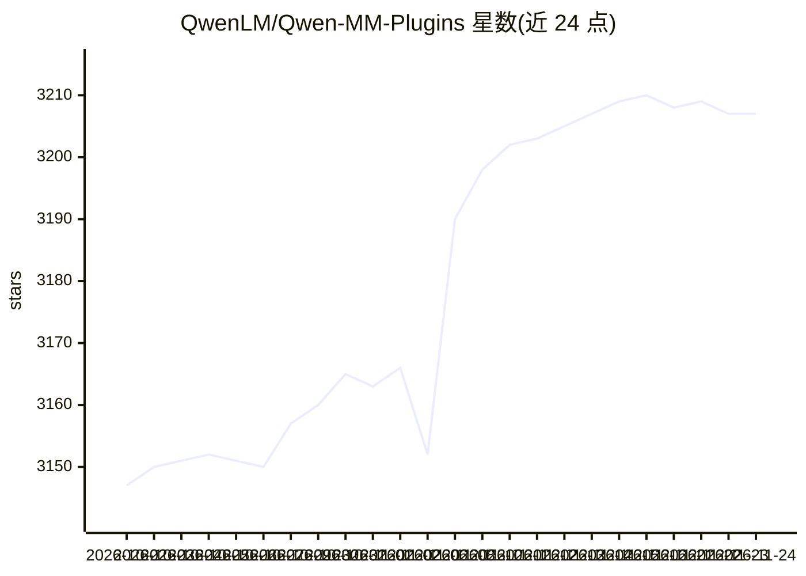

# QwenLM/Qwen-MM-Plugins

⭐ 3,210 · Python · Apache-2.0 · 推送 2026-11-10 · [GitHub](https://github.com/QwenLM/Qwen-MM-Plugins) · 组织维护 · 中文 README

**为 agent harness 提供原生气多模态插件的 Qwen 工具集**

Qwen 团队发布的插件集，将图像、视频、文档、音频与 3D 文件的读取和处理能力以 Skill 加可选 MCP server 的形式安装到各类 agent harness 中。每个能力独立安装并按主模型类型分组：通用能力（core 本地读图/视频/文档、api 调模型服务、search、mhs 操作硬件）、面向 Qwen VL 系列的能力（长视频记忆、视频编辑、3D 空间问答、Blender/FreeCAD 驱动、教育视频生成）与面向 Qwen Omni 系列的能力（视频切剪、视频转笔记、技能生成、视听记忆、深度研究）。提供 curl 引导安装器与 update 命令，共享配置位于 ~/.qwen-mm-plugins/config。

## 筛选速览

| 维度 | 判定 | 备注 |
|---|---|---|
| AI 角色 | `ai-ecosystem` | LLM/agent 周边工具 |
| 许可风险 | `permissive` | Apache-2.0 |
| 部署形态 | `None` |  |
| 模型依赖 | — | README 未给出锁定关系 |
| 硬件要求 | — | 无带数字的原话,不猜 |
| 安装摩擦 | `medium` | 含编译或系统依赖之一 |
| 成熟度 | — | 结构信号不足 |

## 能力要点

- 每个能力独立安装为 Skill 加可选 MCP server（qwen-mm-plugins-<capability>）
- core 插件默认原生模式读图/视频/文件，无需 API key
- 引导安装器支持 Claude Code、Codex、Qwen Code 等多种 harness
- mhs 插件经 Model Hardware Standard 适配器操作真实硬件，含安全限制与紧急停止

## 适用场景

- 让 agent 直接读取并总结本地 PDF、视频与图片
- 用 Omni 模型给带说话人标签的会议视频做转录
- 把教程视频转成带插图的 PDF 笔记
- 通过 agent 驱动 Blender/FreeCAD 做建模与参数化 CAD

## 场景标签

`多模态` `文档解析` · 领域:知识与检索

## 证据(README 行号)

> L5: Native multimodal plugins for Qwen models. Make any agent harness multimodal-native.
> L64: Each capability is installed independently as a **Skill** plus an optional **MCP server**, named

## 星数曲线

2026-10-22 3,147 → 2026-11-24 3,207（+60）

---
*卡片 v1 · prompt 1.4 · 生成 2026-11-23 · 置信度 high · 依据 README sha `a5a5d6921fa8` · [字段定义](../../DATASET.md)*
