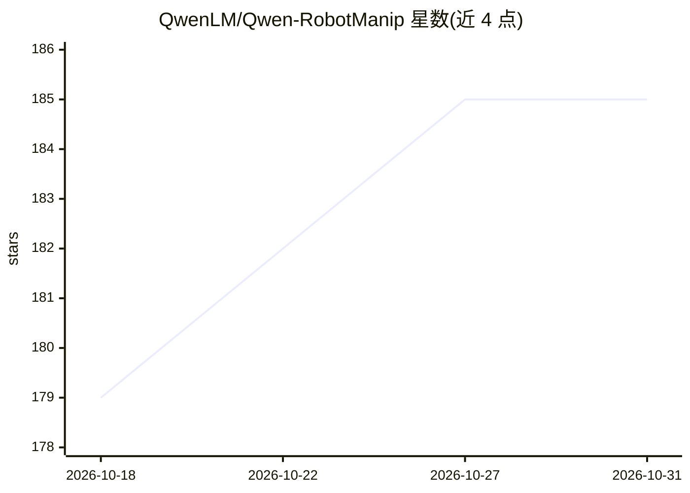

# QwenLM/Qwen-RobotManip

⭐ 185 · 推送 2026-06-29 · [GitHub](https://github.com/QwenLM/Qwen-RobotManip) · 组织维护 · 中文 README

**机器人操作基础模型：面向研究者的 VLA 模型技术报告仓库**

Qwen 团队的视觉-语言-动作（VLA）机器人操作基础模型官方仓库。模型基于 Qwen-VL / Qwen3.5-4B 视觉语言骨干，配合流匹配 Diffusion Transformer 动作专家生成连续动作；提出表示、运动、行为三维对齐框架，用统一 80 维状态-动作表示覆盖单臂/双臂/灵巧手/移动操作等多种本体。预训练语料约 38,100 小时，含 24,808 小时人转机器人合成演示。README 明确说明目前不发布模型权重，仓库主要提供技术报告、博客、演示视频与基准结果，面向机器人学习研究者。

## 筛选速览

| 维度 | 判定 | 备注 |
|---|---|---|
| AI 角色 | `ai-native` | 本体是模型或模型工具 |
| 许可风险 | `none` | — |
| 部署形态 | `None` |  |
| 模型依赖 | — | README 未给出锁定关系 |
| 硬件要求 | — | 无带数字的原话,不猜 |
| 安装摩擦 | `low` | 无编译、无系统依赖或容器化 |
| 成熟度 | — | 结构信号不足 |

## 能力要点

- Qwen3.5-4B 视觉语言骨干 + 流匹配 DiT 动作专家的动作生成架构
- 80 维统一跨本体状态-动作表示（带逐维二值掩码）
- 约 38,100 小时开源数据预训练，含跨 15 种本体的合成演示管线
- 在 LIBERO-Plus、RoboChallenge Table30 v1 等基准上报告了成功率数据

## 适用场景

- 查阅机器人操作基础模型的技术报告与方法细节
- 了解跨本体对齐与人类视频转机器人演示的合成管线
- 对比 VLA 模型在 LIBERO/RoboTwin 等基准上的自报结果

## 场景标签

`多模态` · 领域:感知与多模态

## 证据(README 行号)

> L39: **Qwen-RobotManip** is a generalizable vision-language-action foundation model built upon **Qwen-VL / Qwen3.5-4B**.
> L61: Qwen-RobotManip combines a **Qwen3.5-4B vision-language backbone** with a **flow-matching DiT action expert**. The 

## 星数曲线

2026-10-18 179 → 2026-10-31 185（+6）

---
*卡片 v1 · prompt 1.4 · 生成 2026-10-22 · 置信度 high · 依据 README sha `3148da985da6` · [字段定义](../../DATASET.md)*
