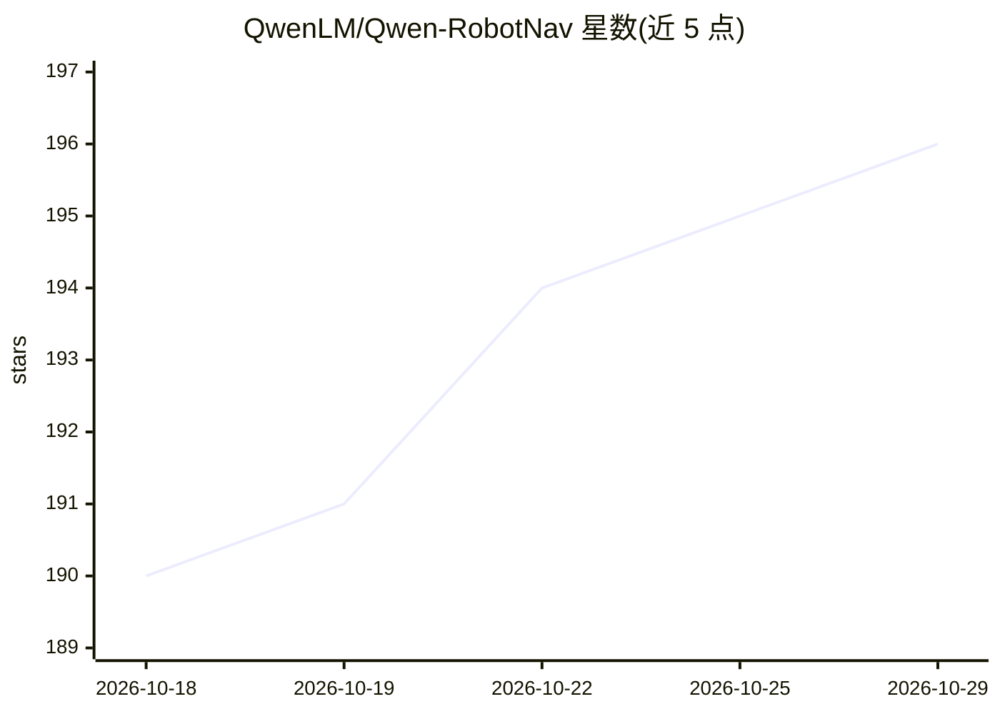

# QwenLM/Qwen-RobotNav

⭐ 196 · 推送 2026-06-30 · [GitHub](https://github.com/QwenLM/Qwen-RobotNav) · 组织维护 · 中文 README

**面向具身智能的统一多域机器人导航模型（基于 Qwen3-VL）**

Qwen 团队的可扩展导航模型，基于 Qwen3-VL 骨干并增加 4 层 MLP 动作头，输出 8 个路标点，将 VLN、PointNav/ObjectNav、目标跟踪、自动驾驶与具身问答统一在同一预测接口下。核心机制是推理时可配置的观测协议（视觉 token 预算、时间衰减、相机权重、帧采样模式），可作为上层规划器调用的导航原语。在 15.6M 样本上训练，提供 2B-8B 规模并在 Unitree Go2/Jetson Thor 上零样部署验证。注意：官方声明暂不发布模型权重，仓库目前主要承载技术报告、博客与演示资源。

## 筛选速览

| 维度 | 判定 | 备注 |
|---|---|---|
| AI 角色 | `ai-native` | 本体是模型或模型工具 |
| 许可风险 | `none` | — |
| 部署形态 | `None` |  |
| 模型依赖 | — | README 未给出锁定关系 |
| 硬件要求 | — | 无带数字的原话,不猜 |
| 安装摩擦 | `low` | 无编译、无系统依赖或容器化 |
| 成熟度 | — | 结构信号不足 |

## 能力要点

- 一个模型覆盖 VLN、PointNav/ObjectNav、目标跟踪、自动驾驶与具身问答
- 推理时可配置的观测协议（token 预算/时间衰减/相机权重/帧采样）
- 4 层 MLP 动作头输出 8 个 (x,y,theta) 路标点
- 15.6M 样本训练，零样迁移到 Unitree Go2 实机（Jetson Thor，196ms 延迟）

## 适用场景

- 具身智能研究中作为上层规划器可调用的导航执行原语
- 四足机器人零样自然语言指令跟随与长程导航
- 自动驾驶与目标跟踪基准评测

## 场景标签

 · 领域:机器人/具身智能导航

## 证据(README 行号)

> L35: **Qwen-RobotNav** is a scalable navigation model built on **Qwen3-VL**. It unifies instruction following, point-goa
> L57: Qwen-RobotNav inherits the Qwen3-VL backbone and adds a lightweight **4-layer MLP action head**. It outputs **8 way
> L135: Qwen-RobotNav is deployed zero-shot on a **Unitree Go2** quadruped robot with on-device inference via **NVIDIA Jet

## 星数曲线

2026-10-18 190 → 2026-10-29 196（+6）

---
*卡片 v1 · prompt 1.4 · 生成 2026-10-22 · 置信度 high · 依据 README sha `76770118b02f` · [字段定义](../../DATASET.md)*
