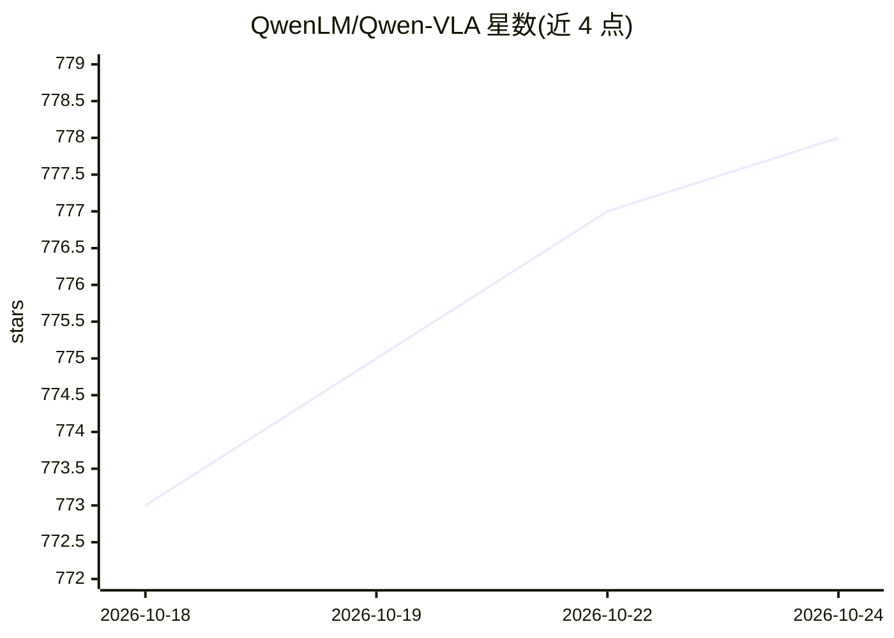

# QwenLM/Qwen-VLA

⭐ 778 · 推送 2026-05-29 · [GitHub](https://github.com/QwenLM/Qwen-VLA) · 组织维护

**统一视觉-语言-动作机器人通用模型，跨任务/环境/本体**

Qwen 团队发布的视觉-语言-动作（VLA）通用模型：基于 Qwen3.5-4B 视觉语言主干与 1.15B DiT 流匹配动作解码器，将操作、导航与轨迹预测纳入同一动作-轨迹预测框架，通过本体感知的 prompt 条件化以一套权重服务多个机器人平台。训练流程包含大规模动作预训练、多模态持续预训练、监督微调与强化学习。提供 Base 与 Instruct 两个版本，并在 LIBERO、RoboTwin、SimplerEnv 及 ALOHA 真机平台上给出基准结果；README 未给出安装或部署命令。

## 筛选速览

| 维度 | 判定 | 备注 |
|---|---|---|
| AI 角色 | `ai-native` | 本体是模型或模型工具 |
| 许可风险 | `none` | — |
| 部署形态 | `None` |  |
| 模型依赖 | — | README 未给出锁定关系 |
| 硬件要求 | — | 无带数字的原话,不猜 |
| 安装摩擦 | `low` | 无编译、无系统依赖或容器化 |
| 成熟度 | — | 结构信号不足 |

## 能力要点

- 单一模型统一处理操作、导航与轨迹预测
- 换本体仅需更换文本 prompt，无需按平台设计输出头
- 渐进式训练：动作预训练+多模态持续预训练+SFT+RL
- 提供 LIBERO/RoboTwin/SimplerEnv/R2R/ALOHA 等基准成绩表

## 适用场景

- 在多种机器人本体上部署统一操作与导航策略
- 真机操作任务中评估通用模型的域外泛化
- 作为具身智能研究的基线模型引用与对比

## 场景标签

`多模态` · 领域:感知与多模态

## 证据(README 行号)

> L23: **Qwen-VLA** is a unified vision-language-action generalist model built upon **Qwen3.5-4B** (vision-language backbo
> L25: A unified Qwen-VLA generalist **matches or outperforms task-specific specialists** fine-tuned independently per ben

## 星数曲线

2026-10-18 773 → 2026-10-24 778（+5）

---
*卡片 v1 · prompt 1.4 · 生成 2026-10-21 · 置信度 high · 依据 README sha `f9ca1cabf657` · [字段定义](../../DATASET.md)*
