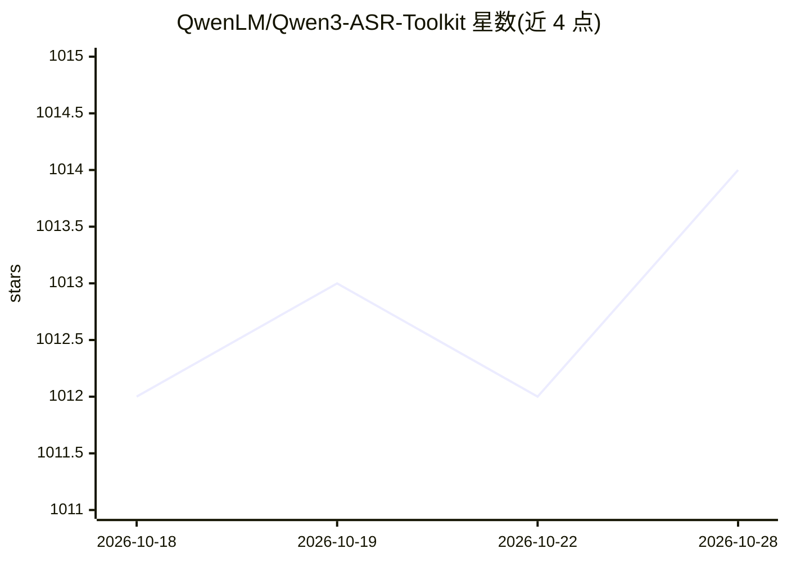

# QwenLM/Qwen3-ASR-Toolkit

⭐ 1,014 · Python · MIT · 推送 2026-02-05 · [GitHub](https://github.com/QwenLM/Qwen3-ASR-Toolkit) · 组织维护 · 中文 README

**调用 Qwen-ASR API 的长音频转写命令行工具**

官方 Python 命令行工具，用于调用 DashScope 的 Qwen-ASR API（原 Qwen3-ASR-Flash）转录长音频/视频：通过 VAD 在静音处切分为 120 秒（可配置）以内的分片，多线程并发调用 API 绕过 3 分钟时长限制，再聚合结果并去除重复与幻觉文本，输出 .txt，可选生成带时间戳的 .srt 字幕；自动重采样任意格式媒体（依赖 FFmpeg），支持本地文件与 URL 输入，支持 -c 参数传入术语上下文。需 DashScope API Key，PyPI 安装后以 qwen3-asr 命令运行。

## 筛选速览

| 维度 | 判定 | 备注 |
|---|---|---|
| AI 角色 | `ai-native` | 本体是模型或模型工具 |
| 许可风险 | `permissive` | MIT |
| 部署形态 | `library` | 以包/库形式分发 |
| 模型依赖 | — | README 未给出锁定关系 |
| 硬件要求 | — | 无带数字的原话,不猜 |
| 安装摩擦 | `medium` | 含编译或系统依赖之一 |
| 成熟度 | — | 结构信号不足 |

## 能力要点

- VAD 静音切分 + 并发 API 调用，绕过 3 分钟音频长度限制
- 自动检测并去除 ASR 重复与幻觉文本的后处理
- 自动重采样任意采样率/声道到 16kHz 单声道，支持多种音视频格式
- 可生成带时间戳的 .srt 字幕文件

## 适用场景

- 把数小时长的讲座、播客视频快速转成文字稿
- 为视频批量生成字幕文件
- 用术语上下文提高专有名词的识别准确率

## 场景标签

`语音识别` · 领域:感知与多模态

## 证据(README 行号)

> L14: An advanced, high-performance Python command-line toolkit for using the **Qwen-ASR API** (formerly Qwen3-ASR-Flash)
> L104: qwen3-asr -i <input_file_or_url> [-key <api_key>] [-j <num_threads>] [-c <context>] [-d <duration>] [-t <tmp_dir>]
> L122: The full transcription result will be printed to the terminal (unless in `--silence` mode) and also saved in a `.t

## 星数曲线

2026-10-18 1,012 → 2026-10-28 1,014（+2）

---
*卡片 v1 · prompt 1.4 · 生成 2026-10-21 · 置信度 high · 依据 README sha `7fd44566c56e` · [字段定义](../../DATASET.md)*
