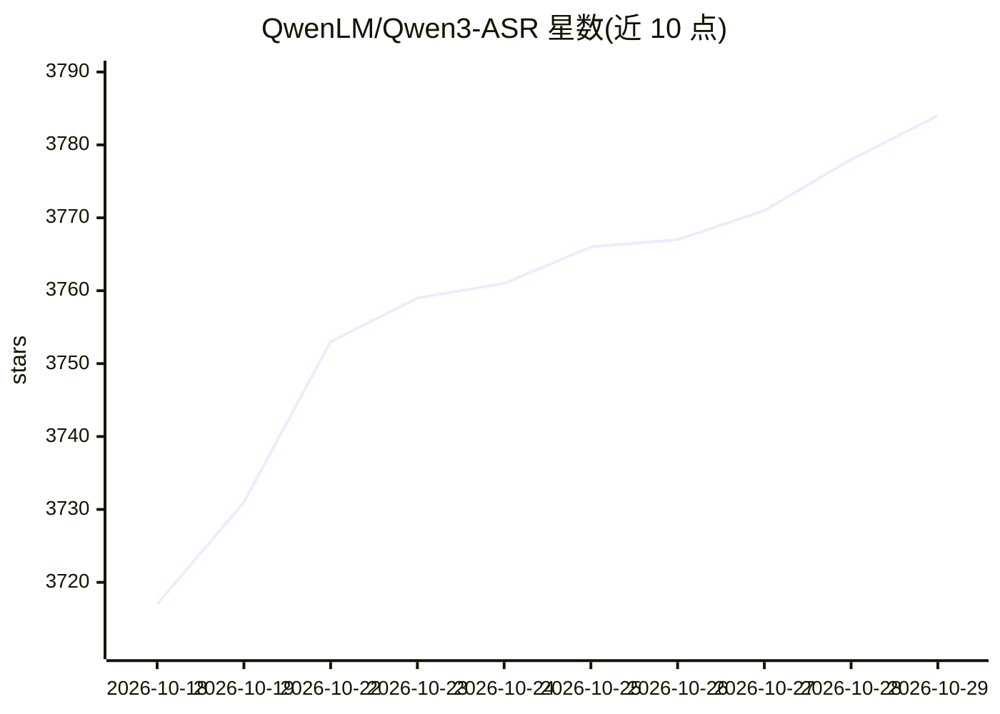

# QwenLM/Qwen3-ASR

⭐ 3,784 · Python · Apache-2.0 · 推送 2026-06-26 · [GitHub](https://github.com/QwenLM/Qwen3-ASR) · 组织维护 · 中文 README

**阿里 Qwen 团队的开源多语言语音识别模型系列（ASR + 强制对齐）**

Qwen3-ASR 系列包含 1.7B/0.6B 两个语音识别模型，支持 52 种语言与方言的语言识别、语音/歌声/带伴奏歌曲识别，覆盖 30 种语言及 22 种中文方言，支持流式与离线统一推理、长音频转写；另含非自回归强制对齐模型 Qwen3-ForcedAligner-0.6B，可为 11 种语言最长 5 分钟语音的任意单元输出词级/字级时间戳。基于 Qwen3-Omni 基座训练。提供 qwen-asr Python 包（transformers/vLLM 双后端）、qwen-asr-serve 服务命令与 Gradio Web Demo，另有 DashScope 商用 API。

## 筛选速览

| 维度 | 判定 | 备注 |
|---|---|---|
| AI 角色 | `ai-native` | 本体是模型或模型工具 |
| 许可风险 | `permissive` | Apache-2.0 |
| 部署形态 | `library` | 以包/库形式分发 |
| 模型依赖 | local-ok | 支持本地模型 |
| 硬件要求 | — | 无带数字的原话,不猜 |
| 安装摩擦 | `medium` | 含编译或系统依赖之一 |
| 成熟度 | — | 结构信号不足 |

## 能力要点

- 52 种语言/方言识别，含 22 种中文方言，支持语音/歌声/带 BGM 歌曲
- 流式与离线统一推理，0.6B 版在并发 128 下达到 2000 倍吞吐描述
- Qwen3-ForcedAligner-0.6B 提供 11 种语言词级/字符级时间戳
- qwen-asr 包含 transformers/vLLM 双后端、流式推理与 Gradio Demo

## 适用场景

- 搭建多语言/方言语音转写服务（离线或流式）
- 为字幕生成、语料对齐获取词级时间戳
- 本地部署或通过 DashScope API 调用 ASR 能力

## 场景标签

`语音识别` · 领域:感知与多模态

## 证据(README 行号)

> L7: We release **Qwen3-ASR**, a family that includes two powerful all-in-one speech recognition models that support lang
> L22: The Qwen3-ASR family includes Qwen3-ASR-1.7B and Qwen3-ASR-0.6B, which support language identification and ASR for 
> L26: * **Excellent and Fast**: The Qwen3-ASR family ASR models maintains high-quality and robust recognition under compl

## 星数曲线

2026-10-18 3,717 → 2026-10-29 3,784（+67）

---
*卡片 v1 · prompt 1.4 · 生成 2026-10-21 · 置信度 high · 依据 README sha `5f2d82b751c2` · [字段定义](../../DATASET.md)*
