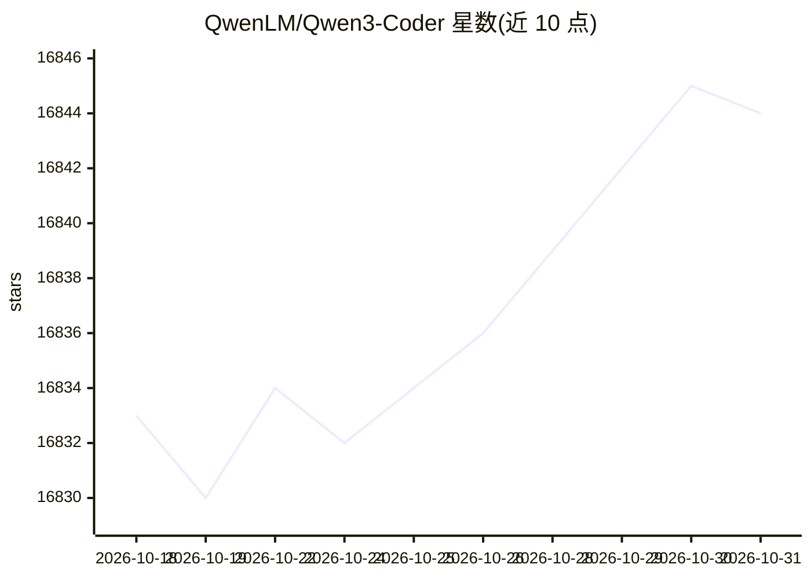

# QwenLM/Qwen3-Coder

⭐ 16,844 · Python · 推送 2026-03-24 · [GitHub](https://github.com/QwenLM/Qwen3-Coder) · 组织维护 · 中文 README

**为开发者提供的代码生成与 Agentic Coding 开源大语言模型系列**

Qwen 团队发布的 Qwen3 系列代码模型，含 Qwen3-Coder-Next（基于 Qwen3-Next-80B-A3B-Base，混合注意力与 MoE 架构）、480B-A35B 与 30B-A3B 三个规模，另有 Base 与 FP8/GGUF 版本。模型原生支持 256K 上下文（可用 Yarn 扩展至 1M），覆盖 358 种编程语言，支持 FIM 代码补全，仅支持非思考模式。提供 transformers 推理示例；function calling 依赖 SGLang 与 vLLM 中的新工具解析器。权重发布于 Hugging Face 与 ModelScope。

## 筛选速览

| 维度 | 判定 | 备注 |
|---|---|---|
| AI 角色 | `ai-native` | 本体是模型或模型工具 |
| 许可风险 | `none` | — |
| 部署形态 | `self-host` | docker 或自建部署 |
| 模型依赖 | local-ok | 支持本地模型 |
| 硬件要求 | — | 无带数字的原话,不猜 |
| 安装摩擦 | `low` | 无编译、无系统依赖或容器化 |
| 成熟度 | — | 结构信号不足 |

## 动量与使用信号

- 维护:`declining` — 距上次 push 208.0 天,年发版 0,34 位贡献者
- 涨星:近 1 天 **-2**(自 20261016 起算)

## 能力要点

- 支持 358 种编程语言与 256K 原生上下文（Yarn 可扩展至 1M）
- 支持 FIM（fill-in-the-middle）代码补全任务
- 兼容 Qwen Code、CLINE、Claude Code 等平台的函数调用格式
- 提供 Instruct/Base 与 FP8/GGUF 多种权重版本

## 适用场景

- 在本地或私有环境中运行代码生成模型辅助开发
- 接入 Qwen Code、Claude Code、Cline 等编码 Agent 工具
- 仓库级代码理解与长上下文代码任务
- IDE 内的代码片段补全（FIM）

## 场景标签

`代码生成` `编码 Agent` · 领域:编码与开发

## 证据(README 行号)

> L13: We are announcing Qwen3-Coder, our most agentic code model to date. **Qwen3-Coder** is available in multiple sizes,
> L15: **Qwen3-Coder-Next**, an open-weight language model designed specifically for coding agents and local development. 
> L23: 📚 **Long-context Capabilities**: with native support for **256K** tokens, extendable up to **1M** tokens using Yarn

## 星数曲线

2026-10-18 16,833 → 2026-10-31 16,844（+11）

---
*卡片 v1 · prompt 1.4 · 生成 2026-10-18 · 置信度 mid · 依据 README sha `70889ab2cd08` · [字段定义](../../DATASET.md)*
