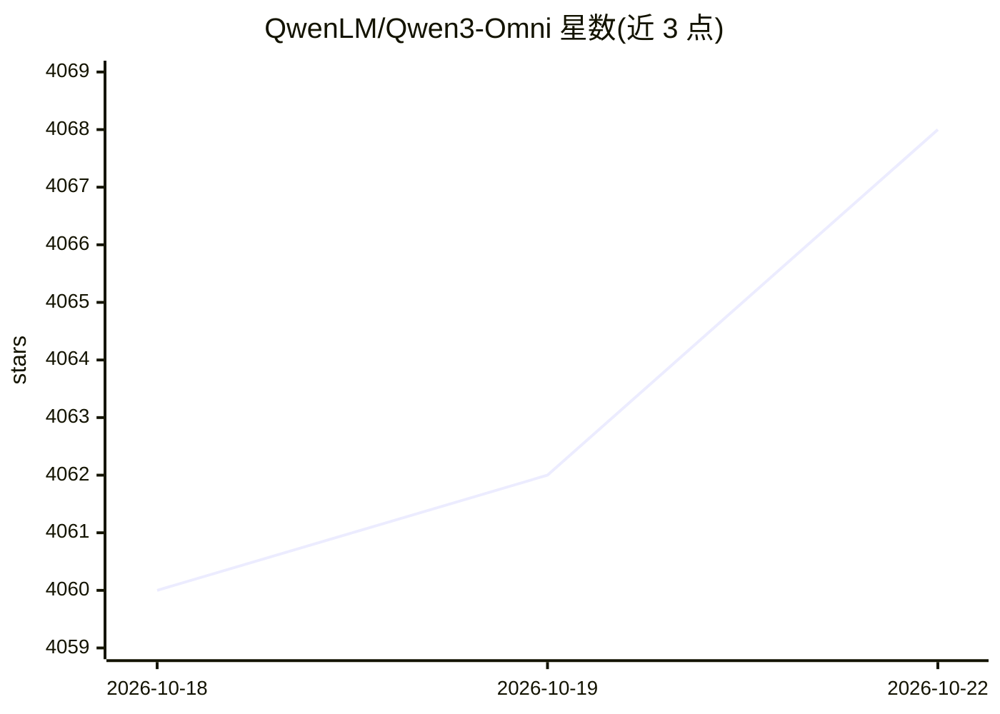

# QwenLM/Qwen3-Omni

⭐ 4,068 · Jupyter Notebook · Apache-2.0 · 推送 2026-04-23 · [GitHub](https://github.com/QwenLM/Qwen3-Omni) · 组织维护 · 中文 README

**阿里 Qwen 团队的端到端全模态模型，理解文/图/音/视频并流式生成语音**

Qwen3-Omni 是阿里云 Qwen 团队开源的端到端多语言全模态基础模型，接收文本、图像、音频、视频输入，实时流式输出文本与语音。架构采用 MoE 的 Thinker–Talker 设计与多码本方案以降低延迟；支持 119 种文本语言、19 种语音输入语言与 10 种语音输出语言。提供 Instruct、Thinking（思维链）与 Captioner（音频细粒度字幕）三个 30B-A3B 版本。可通过 Hugging Face Transformers（≥5.2.0）、vLLM 或 DashScope API 运行，并提供含完整运行环境的 Docker 镜像；Transformers 在 MoE 架构下推理速度较慢，官方推荐 vLLM 用于大规模/低延迟场景。附 Colab 形式的 Cookbooks 覆盖语音识别、OCR、音视频问答、音频函数调用等用例。

## 筛选速览

| 维度 | 判定 | 备注 |
|---|---|---|
| AI 角色 | `ai-native` | 本体是模型或模型工具 |
| 许可风险 | `permissive` | Apache-2.0 |
| 部署形态 | `self-host` | docker 或自建部署 |
| 模型依赖 | local-ok | 支持本地模型 |
| 硬件要求 | — | 无带数字的原话,不猜 |
| 安装摩擦 | `low` | 无编译、无系统依赖或容器化 |
| 成熟度 | — | 结构信号不足 |

## 能力要点

- 文本/图像/音频/视频输入，实时流式文本与语音输出
- MoE Thinker–Talker 架构与多码本设计降低延迟
- 119 种文本语言、19 种语音输入、10 种语音输出
- 提供 Instruct / Thinking / Captioner 三个 30B-A3B 开源模型及 Colab Cookbooks

## 适用场景

- 多语言语音识别、语音翻译与音频分析
- 图像 OCR、目标定位与图像数学题求解
- 音视频实时交互对话与音频驱动的函数调用（Agent）
- 音频细粒度字幕生成（Captioner 模型）

## 场景标签

`多模态` `语音识别` `语音合成` `OCR` · 领域:内容生成

## 证据(README 行号)

> L7: We release **Qwen3-Omni**, the natively end-to-end multilingual omni-modal foundation models. It is designed to proc
> L28: Qwen3-Omni is the natively end-to-end multilingual omni-modal foundation models. It processes text, images, audio, 
> L142: |Qwen3-Omni-30B-A3B-Instruct|The Instruct model of Qwen3-Omni-30B-A3B, containing both thinker and talker, support

## 星数曲线

2026-10-18 4,060 → 2026-10-22 4,068（+8）

---
*卡片 v1 · prompt 1.4 · 生成 2026-10-20 · 置信度 high · 依据 README sha `960218f06709` · [字段定义](../../DATASET.md)*
