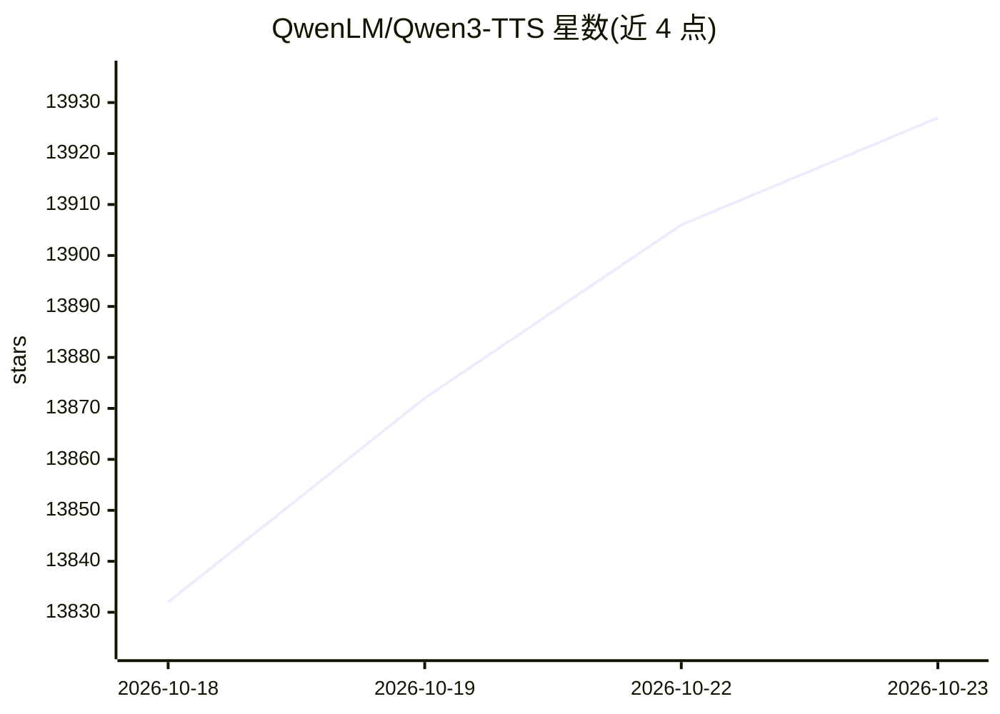

# QwenLM/Qwen3-TTS

⭐ 13,927 · Python · Apache-2.0 · 推送 2026-03-17 · [GitHub](https://github.com/QwenLM/Qwen3-TTS) · 组织维护 · 中文 README

**开发者用的开源 TTS 模型系列：语音克隆、音色设计与流式生成**

阿里通义 Qwen 团队发布的 TTS 模型系列（0.6B/1.7B），基于自研 Qwen3-TTS-Tokenizer-12Hz 与离散多码本 LM 架构，覆盖 10 种语言及多种方言音色。提供三种模型形态：CustomVoice（9 种预置音色加指令风格控制）、VoiceDesign（自然语言描述设计音色）、Base（3 秒参考音频快速克隆，可微调）。单模型同时支持流式与非流式生成，README 称端到端首包延迟可低至 97ms。通过 PyPI 的 qwen-tts 包安装，也可用 vLLM 加载，并提供本地 Web UI demo（Base 模型部署建议 HTTPS 以启用浏览器麦克风）。

## 筛选速览

| 维度 | 判定 | 备注 |
|---|---|---|
| AI 角色 | `ai-native` | 本体是模型或模型工具 |
| 许可风险 | `permissive` | Apache-2.0 |
| 部署形态 | `library` | 以包/库形式分发 |
| 模型依赖 | local-ok | 支持本地模型 |
| 硬件要求 | — | 无带数字的原话,不猜 |
| 安装摩擦 | `low` | 无编译、无系统依赖或容器化 |
| 成熟度 | — | 结构信号不足 |

## 动量与使用信号

- 维护:`declining` — 距上次 push 215.1 天,年发版 0,2 位贡献者
- 涨星:近 1 天 **+12**(自 20261016 起算)
- 安装:pypi 包 `qwen-tts` 月下载 185,729
- 平台:WEB · 协议:—

## 能力要点

- 3 秒参考音频快速语音克隆（Base 模型），支持微调
- 自然语言指令驱动的音色设计与音色/情感/韵律控制
- 单模型流式与非流式生成，双轨混合流式架构
- 覆盖中英日韩德法俄葡西意 10 种语言及多个方言音色

## 适用场景

- 为应用集成低延迟流式语音合成
- 用参考音频克隆特定说话人音色生成内容
- 用文字描述设计角色音色并跨多句复用

## 场景标签

`语音合成` · 领域:内容生成

## 证据(README 行号)

> L7: We release **Qwen3-TTS**, a series of powerful speech generation capabilities developed by Qwen, offering comprehens
> L17: Qwen3-TTS covers 10 major languages (Chinese, English, Japanese, Korean, German, French, Russian, Portuguese, Spani
> L55: The easiest way to quickly use Qwen3-TTS is to install the `qwen-tts` Python package from PyPI. This will pull in t

## 星数曲线

2026-10-18 13,832 → 2026-10-23 13,927（+95）

---
*卡片 v1 · prompt 1.4 · 生成 2026-10-18 · 置信度 high · 依据 README sha `5a02c35d133f` · [字段定义](../../DATASET.md)*
