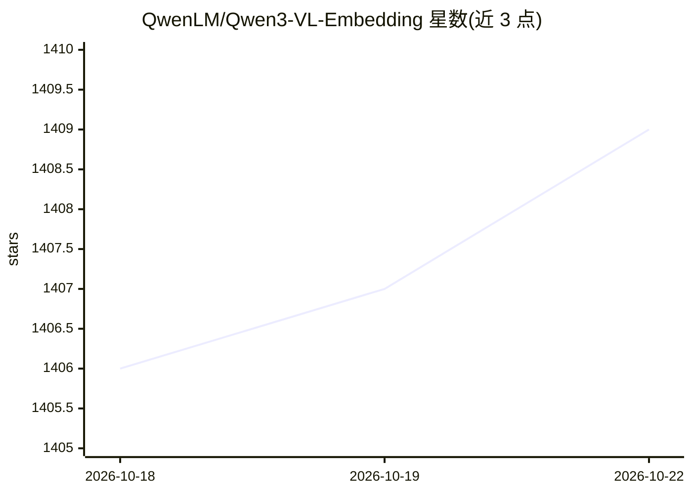

# QwenLM/Qwen3-VL-Embedding

⭐ 1,409 · Python · Apache-2.0 · 推送 2026-06-23 · [GitHub](https://github.com/QwenLM/Qwen3-VL-Embedding) · 组织维护 · 中文 README

**基于 Qwen3-VL 的多模态嵌入与重排序模型系列（2B/8B）**

Qwen 团队在 Qwen3-VL 基础模型上构建的检索模型套件：Embedding 采用双塔架构，将文本、图像、截图、视频及混合模态输入编码为语义向量，取最后层 [EOS] 隐状态作为表示；Reranker 采用单塔架构，对 (Query, Document) 对做交叉注意力融合，通过特殊词元生成概率输出相关性分数。支持 33 种语言、32K 序列长度、MRL 灵活向量维度与量化部署，可通过 Transformers 或 vLLM（≥0.14.0）使用，提供多任务评测示例与端到端多模态 RAG 示例。

## 筛选速览

| 维度 | 判定 | 备注 |
|---|---|---|
| AI 角色 | `ai-native` | 本体是模型或模型工具 |
| 许可风险 | `permissive` | Apache-2.0 |
| 部署形态 | `library` | 以包/库形式分发 |
| 模型依赖 | local-ok | 支持本地模型 |
| 硬件要求 | — | 无带数字的原话,不猜 |
| 安装摩擦 | `low` | 无编译、无系统依赖或容器化 |
| 成熟度 | — | 结构信号不足 |

## 能力要点

- Embedding（双塔）与 Reranker（单塔交叉注意力）配合的两阶段检索
- 统一表示空间处理文本/图像/截图/视频及混合模态输入
- 支持 33 种语言、32K 上下文、MRL 可变向量维度与量化
- 提供 Transformers 与 vLLM（≥0.14.0）两种使用方式及多模态 RAG 端到端示例

## 适用场景

- 为多模态检索系统生成跨模态语义向量做大规模召回
- 对召回的多模态候选做精排以提升检索准确率
- 搭建图文/视频问答与多模态 RAG 管线

## 场景标签

`语义搜索` `多模态` · 领域:知识与检索

## 证据(README 行号)

> L11: **State-of-the-art multimodal embedding and reranking models built on Qwen3-VL, supporting text, images, screenshot
> L19: Building on the success of our text-oriented Qwen3-Embedding and Qwen3-Reranker series, these multimodal models ext
> L94: **Qwen3-VL-Embedding: Dual-Tower Architecture**

## 星数曲线

2026-10-18 1,406 → 2026-10-22 1,409（+3）

---
*卡片 v1 · prompt 1.4 · 生成 2026-10-21 · 置信度 mid · 依据 README sha `8a0998e61f04` · [字段定义](../../DATASET.md)*
