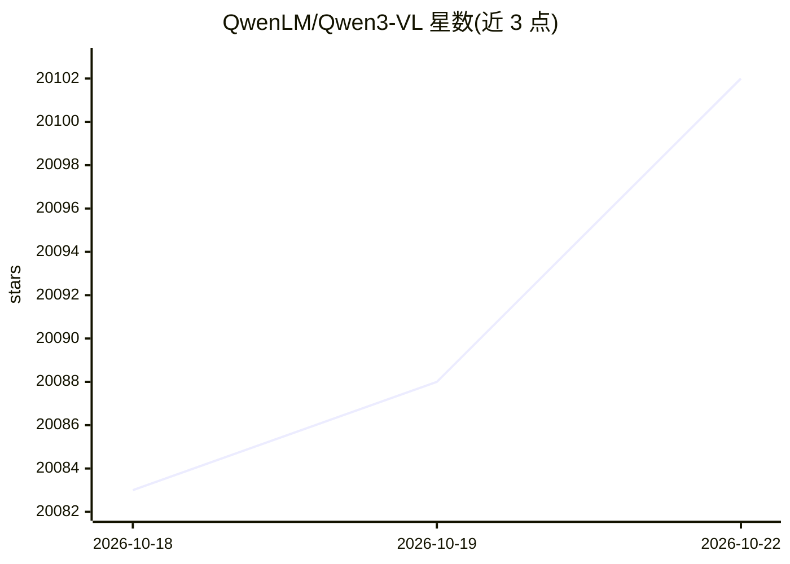

# QwenLM/Qwen3-VL

⭐ 20,109 · Jupyter Notebook · Apache-2.0 · 推送 2026-01-30 · [GitHub](https://github.com/QwenLM/Qwen3-VL) · 组织维护 · 中文 README

**面向开发者的开源多模态视觉语言模型系列及使用代码**

阿里云 Qwen 团队开发的多模态大语言模型系列，提供 Dense 与 MoE 两种架构、2B 到 235B 多种规模及 Instruct/Thinking 版本。模型能力覆盖视觉 Agent（操作 PC/手机 GUI）、从图像/视频生成代码、2D/3D 空间定位、原生 256K 上下文（可扩展至 1M）、32 语言 OCR 等。README 提供 Transformers 与 ModelScope 的推理示例、qwen-vl-utils 工具包用法、图像/视频像素预算控制方法，并附 Colab Cookbook 集合。

## 筛选速览

| 维度 | 判定 | 备注 |
|---|---|---|
| AI 角色 | `ai-native` | 本体是模型或模型工具 |
| 许可风险 | `permissive` | Apache-2.0 |
| 部署形态 | `self-host` | docker 或自建部署 |
| 模型依赖 | local-ok | 支持本地模型 |
| 硬件要求 | — | 无带数字的原话,不猜 |
| 安装摩擦 | `low` | 无编译、无系统依赖或容器化 |
| 成熟度 | — | 结构信号不足 |

## 动量与使用信号

- 维护:`declining` — 距上次 push 261.2 天,年发版 0,47 位贡献者
- 涨星:近 1 天 **+1**(自 20261016 起算)
- 安装:pypi 包 `qwen-vl-utils` 月下载 1,372,247

## 能力要点

- 提供 2B/4B/8B/32B/30B-A3B/235B-A22B 多种规模的 Dense 与 MoE 模型及 FP8 版本
- 支持 32 语言 OCR、原生 256K 上下文（可扩展至 1M）与小时级视频理解
- 提供 qwen-vl-utils 工具包控制图像/视频像素预算与视觉 token 数量
- 通过 Colab 提供 12 类能力 Cookbook（识别、文档解析、视频理解、Agent 等）

## 适用场景

- 构建操作 PC/手机图形界面的视觉 Agent
- 文档解析、OCR 与关键信息抽取
- 长视频理解与时间戳定位
- 基于图像/视频生成前端代码

## 场景标签

`多模态` `文档解析` `OCR` `GUI 自动化` · 领域:效率与自动化

## 证据(README 行号)

> L1: # Qwen3-VL
> L8: Meet Qwen3-VL — the most powerful vision-language model in the Qwen series to date.
> L12: Available in Dense and MoE architectures that scale from edge to cloud, with Instruct and reasoning‑enhanced Thinki

## 星数曲线

2026-10-18 20,083 → 2026-10-22 20,102（+19）

---
*卡片 v1 · prompt 1.4 · 生成 2026-10-18 · 置信度 high · 依据 README sha `64a9bd7aa55f` · [字段定义](../../DATASET.md)*
