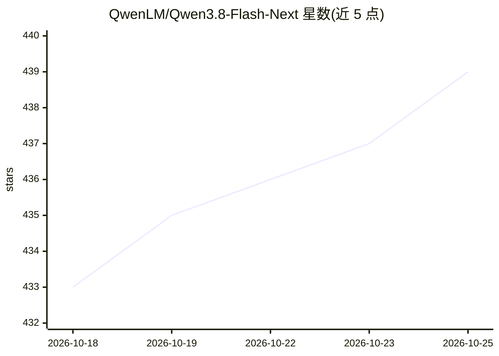

# QwenLM/Qwen3.8-Flash-Next

⭐ 439 · 推送 2026-08-27 · [GitHub](https://github.com/QwenLM/Qwen3.8-Flash-Next) · [官网](https://qwen.ai) · 组织维护 · 中文 README

**阿里 Qwen 团队开源的 125B 多模态 MoE 基础模型权重**

Qwen3.8-Flash-Next 是 Qwen 团队发布的开源权重多模态 MoE 基础模型，作为 Qwen4 架构的早期预览。主模型 125B 参数、每 token 激活 6B，附加 51B N-gram 嵌入；架构采用 GDN+QSA 混合注意力、4 分支门控残差、N-gram 嵌入与 Muon 优化器。权重发布于 Hugging Face 与 ModelScope，支持 transformers serve、llama.cpp、MLX、SGLang、vLLM、TokenSpeed 部署，提供 OpenAI 兼容 API；许可文件随权重发布。

## 筛选速览

| 维度 | 判定 | 备注 |
|---|---|---|
| AI 角色 | `ai-native` | 本体是模型或模型工具 |
| 许可风险 | `none` | — |
| 部署形态 | `None` |  |
| 模型依赖 | local-ok | 支持本地模型 |
| 硬件要求 | — | 无带数字的原话,不猜 |
| 安装摩擦 | `low` | 无编译、无系统依赖或容器化 |
| 成熟度 | `idea` | |

## 能力要点

- 125B 参数 MoE，每 token 激活 6B，附加 51B N-gram 嵌入
- GDN+Qwen Sparse Attention 混合注意力与 4 分支门控残差架构
- 支持 transformers、llama.cpp、MLX、SGLang、vLLM、TokenSpeed 等本地运行与部署
- 作为 Qwen4 架构的早期预览开源发布

## 适用场景

- 通过 vLLM/SGLang 等框架自部署 OpenAI 兼容推理服务
- 在 Apple Silicon 上用 MLX 运行量化版本
- 基于该架构预研或微调（SFT/DPO/GRPO）

## 场景标签

`多模态` `微调` · 领域:感知与多模态

## 证据(README 行号)

> L15: In this release we are opening the weights of **Qwen3.8-Flash-Next**, a multimodal MoE model that also serves as an
> L29: Qwen3.8-Flash-Next features a **125B**-parameter main model, supplemented by an additional **51B** N-gram embedding
> L39: - 🤗Hugging Face Hub: Most LLM frameworks and applications support downloading model files from Hugging Face Hub aut

## 星数曲线

2026-10-18 433 → 2026-10-25 439（+6）

---
*卡片 v1 · prompt 1.4 · 生成 2026-10-21 · 置信度 high · 依据 README sha `7cd70b4a1e99` · [字段定义](../../DATASET.md)*
