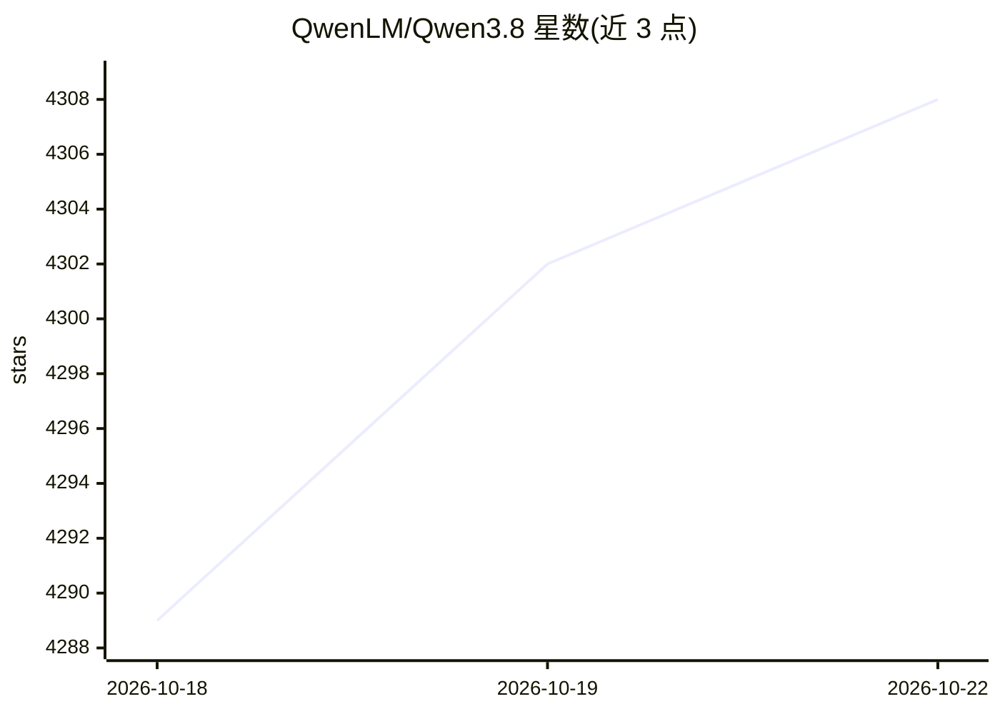

# QwenLM/Qwen3.8

⭐ 4,308 · Apache-2.0 · 推送 2026-08-17 · [GitHub](https://github.com/QwenLM/Qwen3.8) · [官网](https://qwen.ai) · 组织维护 · 中文 README

**阿里 Qwen 团队的开源大模型系列仓库（Qwen3.5/3.6/3.8）**

阿里巴巴 Qwen 团队官方仓库，发布 Qwen3.5、Qwen3.6、Qwen3.8 开放权重模型系列，涵盖 0.8B 到 2.4T-A95B 等规格，权重托管于 Hugging Face 与 ModelScope。Qwen3.8 定位为 Qwen-Max 级开源模型，面向编码、专业工作、研究与长程 agentic 任务，支持 reasoning_effort 调节推理深度、preserve_thinking 保留历史推理上下文。README 提供官方体验渠道（Qwen Studio/Qoder/QwenWork/Qwen API/Qwen Code）及本地部署方式：transformers serve、llama.cpp（GGUF）、MLX、Unsloth、SGLang、vLLM、TokenSpeed；微调建议使用 Unsloth/Swift/Llama-Factory。许可文件随模型权重发布。

## 筛选速览

| 维度 | 判定 | 备注 |
|---|---|---|
| AI 角色 | `ai-native` | 本体是模型或模型工具 |
| 许可风险 | `permissive` | Apache-2.0 |
| 部署形态 | `None` |  |
| 模型依赖 | local-ok | 支持本地模型 |
| 硬件要求 | — | 无带数字的原话,不猜 |
| 安装摩擦 | `low` | 无编译、无系统依赖或容器化 |
| 成熟度 | — | 结构信号不足 |

## 能力要点

- 多规格开放权重模型（含 MoE 架构，最大 2.4T-A95B）
- reasoning_effort 调节推理深度、preserve_thinking 保留历史推理上下文
- 统一视觉-语言基座（Qwen3.5，早期融合训练，201 种语言/方言）
- 提供 transformers/llama.cpp/MLX/SGLang/vLLM/TokenSpeed 等多种部署路径

## 适用场景

- 本地部署或通过推理框架服务 Qwen3.8 模型并获得 OpenAI 兼容 API
- 通过 Qwen Studio/Qoder/QwenWork 在线试用或集成到工作流
- 下载开放权重进行微调（SFT/DPO/GRPO）与二次开发

## 场景标签

 · 领域:大模型/基础模型

## 证据(README 行号)

> L9: Welcome to the GitHub repository of the Qwen3.5 open model series, including Qwen3.5, Qwen3.6, and the latest Qwen3.
> L15: For the first time, Qwen3.8 brings a Qwen-Max-class model to open release. Built on the architectural foundation of
> L55: The official model weights are released on:

## 星数曲线

2026-10-18 4,289 → 2026-10-22 4,308（+19）

---
*卡片 v1 · prompt 1.4 · 生成 2026-10-20 · 置信度 high · 依据 README sha `8447db685d8a` · [字段定义](../../DATASET.md)*
