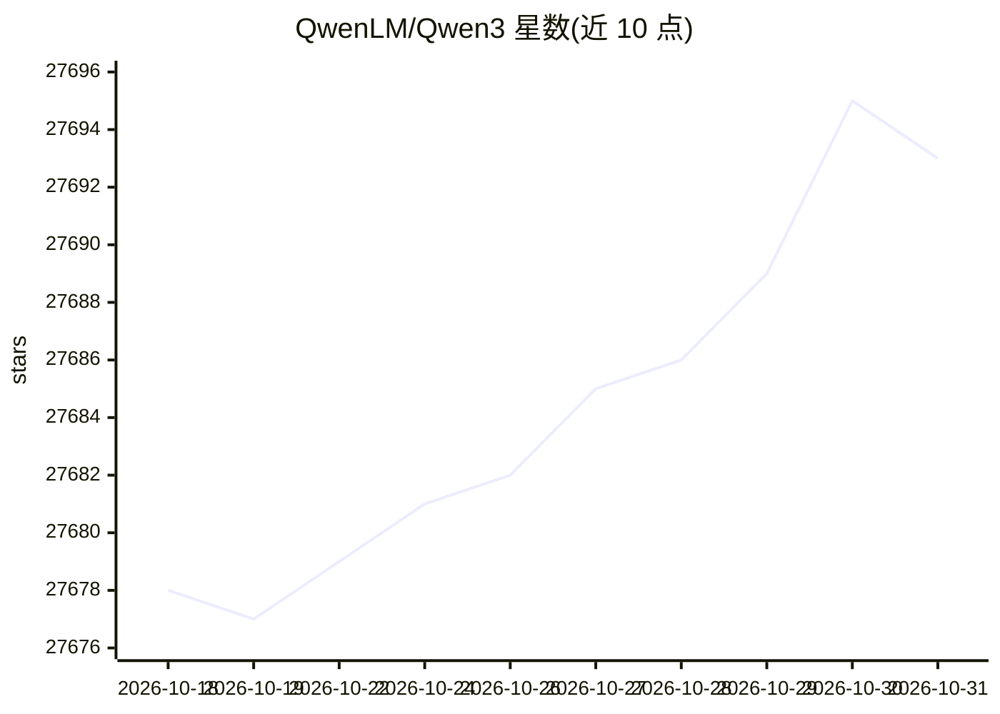

# QwenLM/Qwen3

⭐ 27,693 · Python · 推送 2026-01-09 · [GitHub](https://github.com/QwenLM/Qwen3) · 组织维护 · 中文 README

**阿里通义千问团队的开源大语言模型系列 Qwen3**

Qwen3 是阿里云 Qwen 团队开发的大语言模型系列，提供密集与 MoE 两种结构、0.6B 到 235B-A22B 多种规模，以及 Instruct 与 Thinking 两种 2507 变体。README 给出通过 Transformers、llama.cpp、Ollama、LM Studio、MLX 等框架运行模型的方式，并提供涵盖推理、本地运行、部署、量化（GPTQ/AWQ/GGUF）与后训练（SFT/RLHF）的文档指引。权重公开在 Hugging Face 与 ModelScope，支持 100+ 语言与 256K 上下文（可扩展至 1M token）。

## 筛选速览

| 维度 | 判定 | 备注 |
|---|---|---|
| AI 角色 | `ai-native` | 本体是模型或模型工具 |
| 许可风险 | `none` | — |
| 部署形态 | `None` |  |
| 模型依赖 | local-ok | 支持本地模型 |
| 硬件要求 | — | 无带数字的原话,不猜 |
| 安装摩擦 | `low` | 无编译、无系统依赖或容器化 |
| 成熟度 | — | 结构信号不足 |

## 动量与使用信号

- 维护:`declining` — 距上次 push 282.2 天,年发版 0,46 位贡献者
- 涨星:近 1 天 **+6**(自 20261016 起算)
- 平台:— · 协议:OPENAI-API / MCP / OLLAMA

## 能力要点

- 密集与 MoE 模型，0.6B 至 235B-A22B 共 9 种规模
- Thinking/Non-thinking 两种模式变体（2507 版本各自独立模型）
- 支持 100+ 语言与 256K 长上下文，可扩展至 1M token
- 提供 Transformers、llama.cpp、Ollama、MLX 等多框架运行指引

## 适用场景

- 本地或云端部署开源大模型用于推理服务
- 移动端/端侧运行模型（ExecuTorch、MNN）
- 构建 RAG、Agent 等应用接入 Qwen3
- 对模型做量化以在消费级硬件上运行

## 场景标签

 · 领域:AI 模型/大语言模型

## 证据(README 行号)

> L40:  We are excited to announce the release of Qwen3, the latest addition to the Qwen family of large language models.
> L46:  Dense and Mixture-of-Experts (MoE) models of various sizes , available in 0.6B, 1.7B, 4B, 8B, 14B, 32B and 30B-A3B
> L74: ### 🤗 Transformers

## 星数曲线

2026-10-18 27,678 → 2026-10-31 27,693（+15）

---
*卡片 v1 · prompt 1.4 · 生成 2026-10-18 · 置信度 high · 依据 README sha `df0b1551d86a` · [字段定义](../../DATASET.md)*
