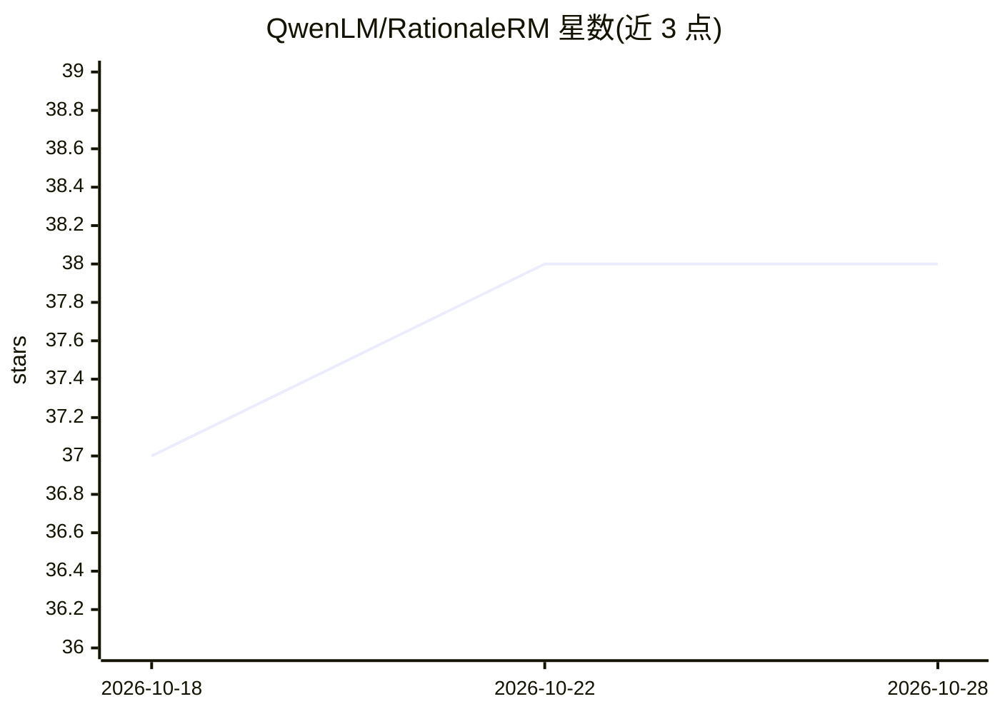

# QwenLM/RationaleRM

⭐ 38 · Python · 推送 2026-03-18 · [GitHub](https://github.com/QwenLM/RationaleRM) · 组织维护 · 中文 README

**对齐奖励模型推理过程的研究项目与评测框架**

Qwen 团队与复旦大学合作的研究项目：发现生成式奖励模型与 LLM-as-a-Judge 存在'欺骗性对齐'问题——模型可通过表面线索得出与人类相同的结论。提出 Rationale Consistency 度量与 MetaJudge 框架，将人类与模型的理由分解为原子单元并做一对一语义匹配，输出 Precision/Recall/F1/AP。推理脚本通过 OpenAI 兼容 API 调用 LLM（如 gpt-4o、qwen-plus）执行匹配，并发布 HelpSteer3 人类标注数据集与 1000 条测试集。

## 筛选速览

| 维度 | 判定 | 备注 |
|---|---|---|
| AI 角色 | `ai-ecosystem` | LLM/agent 周边工具 |
| 许可风险 | `none` | — |
| 部署形态 | `None` |  |
| 模型依赖 | — | README 未给出锁定关系 |
| 硬件要求 | — | 无带数字的原话,不猜 |
| 安装摩擦 | `low` | 无编译、无系统依赖或容器化 |
| 成熟度 | — | 结构信号不足 |

## 能力要点

- MetaJudge 框架：原子理由分解 + 一对一语义匹配计算 Rationale Consistency
- 发布 HelpSteer3 Human Checklist 数据集与 1000 条含模型 checklist 的测试集
- 混合奖励训练：结合理由奖励（AP）与结果奖励
- 在 RM-Bench（87.1%）与 JudgeBench（82.0%）报告结果

## 适用场景

- 评测奖励模型/LLM 裁判的推理过程是否与人类一致
- 检测模型依赖表面线索的欺骗性对齐
- 用带人类原子理由标注的数据训练奖励模型

## 场景标签

`模型评测` · 领域:评测与运维

## 证据(README 行号)

> L19: **RationaleRM** is a research project that investigates how to align not just the *outcomes* but also the *reasonin
> L25: - 🔍 **MetaJudge Framework**: Decomposes human rationales into atomic units and uses LLMs for strict one-to-one sema
> L125: - `--model`: LLM model for semantic matching (e.g., gpt-4o, qwen-plus)

## 星数曲线

2026-10-18 37 → 2026-10-28 38（+1）

---
*卡片 v1 · prompt 1.4 · 生成 2026-10-25 · 置信度 high · 依据 README sha `972712375435` · [字段定义](../../DATASET.md)*
