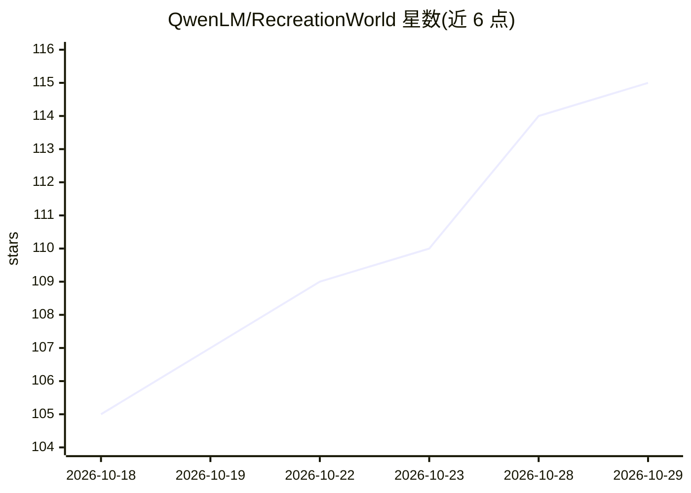

# QwenLM/RecreationWorld

⭐ 115 · Python · MIT · 推送 2026-10-26 · [GitHub](https://github.com/QwenLM/RecreationWorld) · [官网](https://recreation-bench.cc) · 组织维护 · 中文 README

**面向混合计算机操作 agent 的五平台可验证评测环境与基准**

提供覆盖 Ubuntu/macOS/Windows/Android/Web 五平台各 50 个任务的框架，用于研究与训练混合型 computer-use agent：agent 以运行中的参考应用为可执行判据，循环执行 GUI 探索、编码实现与视觉验证，最终由冻结的程序化断言与视觉断言打分，评分基于可观察行为而非源码相似度。附带 RecreationBench 250 个保留任务及多模型成绩表。运行需 uv 安装、任务包、预配置执行环境与模型/评判端点，MIT 许可。

## 筛选速览

| 维度 | 判定 | 备注 |
|---|---|---|
| AI 角色 | `ai-ecosystem` | LLM/agent 周边工具 |
| 许可风险 | `permissive` | MIT |
| 部署形态 | `None` |  |
| 模型依赖 | — | README 未给出锁定关系 |
| 硬件要求 | — | 无带数字的原话,不猜 |
| 安装摩擦 | `low` | 无编译、无系统依赖或容器化 |
| 成熟度 | — | 结构信号不足 |

## 能力要点

- 五平台（Ubuntu/macOS/Windows/Android/Web）各 50 个任务，评估接口含 AT-SPI、AXUIElement、UI Automation、UiAutomator、浏览器断言
- explore–implement–verify 循环式任务框架，agent 可用 GUI 控制与软件开发工具
- 参考验证的程序化与视觉双断言评测，不依赖源码相似度
- RecreationBench 250 个保留任务与多模型成本/分数榜单

## 适用场景

- 评测与比较各模型在跨平台计算机操作任务上的表现
- 为 computer-use agent 生成可验证的训练经验
- 研究 GUI 操作与编码工具交替的混合 agent 行为

## 场景标签

`模型评测` · 领域:评测与运维

## 证据(README 行号)

> L11: RecreationWorld is a five-platform framework for studying and improving **hybrid computer-use agents** that autonom
> L21: The final candidate is evaluated by a frozen suite of reference-validated programmatic and visual assertions. Scori
> L23: ## RecreationBench Results

## 星数曲线

2026-10-18 105 → 2026-10-29 115（+10）

---
*卡片 v1 · prompt 1.4 · 生成 2026-10-23 · 置信度 high · 依据 README sha `7dd2ec89011d` · [字段定义](../../DATASET.md)*
